<div align="center">

# ayni

### Pasanakus hechos sobre PayPal y Claude.
*Hoy por ti, mañana por mí.*

[English](README.md) · **Español**

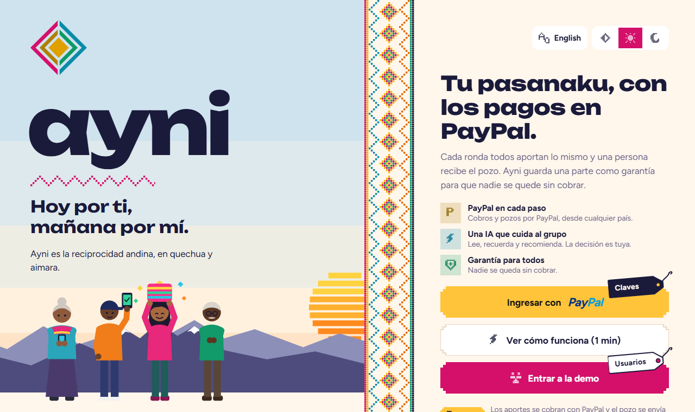

[▶ Video de la demo](YOUTUBE_URL) &nbsp;·&nbsp; [🌐 Demo en línea](RENDER_URL) &nbsp;·&nbsp; [📱 APK de Android](APK_URL) &nbsp;·&nbsp; [🧪 Jurado: cuentas de prueba](#-pruébalo-en-dos-minutos)


</div>

---

## El problema

Cientos de millones de personas ahorran en **grupos rotativos** (*pasanaku* en Bolivia, *tanda* en México, *ROSCA* en el resto del mundo). Todos aportan lo mismo cada semana o cada mes, y en cada ronda un miembro se lleva el pozo completo. Sin banco, sin intereses, sin papeles.

Funcionan con confianza, y se rompen de dos formas previsibles:

1. **Quien cobra el pozo al principio deja de pagar.** El resto del grupo se queda con la pérdida.
2. **Solo funcionan entre personas que ya se conocen.** Alguien en Madrid no puede ahorrar con su familia en La Paz, y a un desconocido no se le confía el pozo.

## La solución

Ayni conserva la tradición y arregla los dos problemas. Cada aporte y cada pozo pasan por **PayPal**, y **Claude** ayuda al grupo a organizarse, pero nunca toca el dinero.

<table>
<tr>
<td width="33%" valign="top">

### 🛡 Garantía escalonada
Quien cobra temprano recibe ahora la mayor parte del pozo; una parte queda **retenida y se devuelve sola** cuando termina de aportar. El turno 1 lleva la mayor garantía y el último no lleva ninguna. Si alguien deja de pagar, el grupo se cubre con su propia garantía.

</td>
<td width="33%" valign="top">

### 🪪 Pasaporte de confianza verificado
Pasanakus completados, puntualidad, pagos atrasados, cuenta de PayPal verificada. Se construye **solo con cómo pagas dentro de Ayni**, nunca con edad, origen o género. Permite que desconocidos formen **pasanakus abiertos** entre países.

</td>
<td width="33%" valign="top">

### 🤖 Una IA que propone y no paga
Claude lee el grupo, escribe recordatorios, media en los conflictos y recomienda admisiones. Todo lo que mueve dinero se convierte en una **decisión que aprueba la organizadora**, y cada acción de la IA queda en un registro que todo el grupo puede leer.

</td>
</tr>
</table>

---

## Míralo

<table>
<tr>
<td width="50%">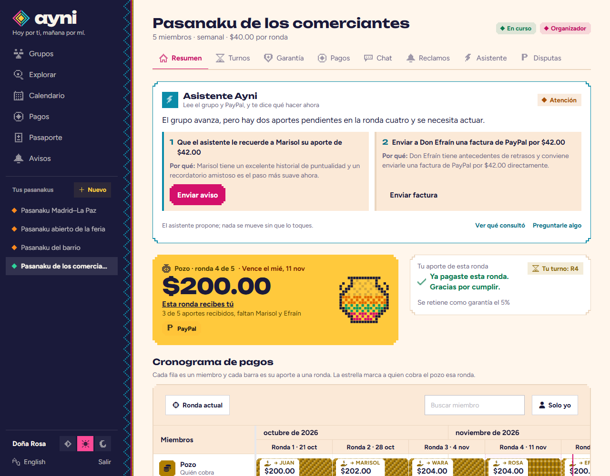<br><sub><b>El pasanaku de un vistazo.</b> El pozo, tu turno, la lectura de la ronda por el asistente con los próximos pasos, y el cronograma de pagos.</sub></td>
<td width="50%">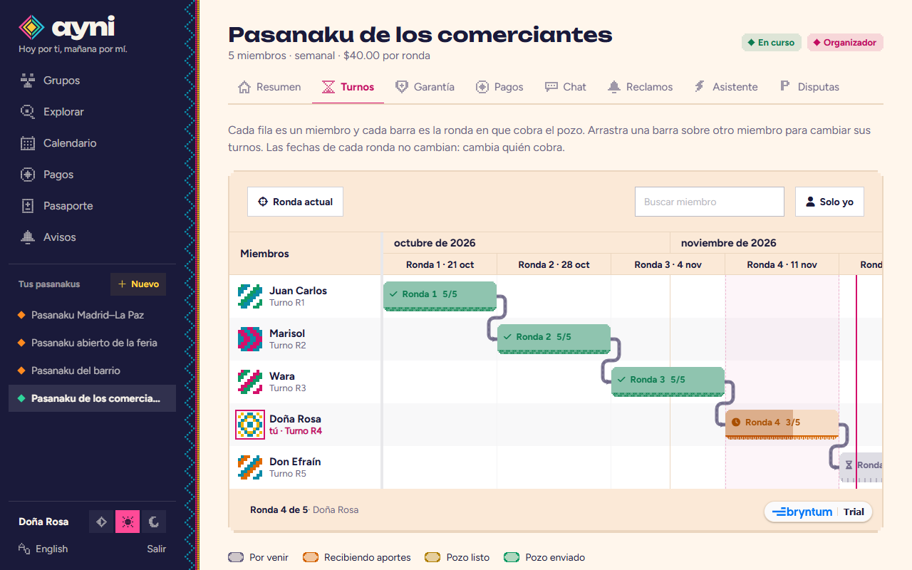<br><sub><b>Cronograma de turnos</b> con Bryntum Scheduler. Quién cobra en cada ronda; la organizadora arrastra un turno para cambiarlo.</sub></td>
</tr>
<tr>
<td width="50%">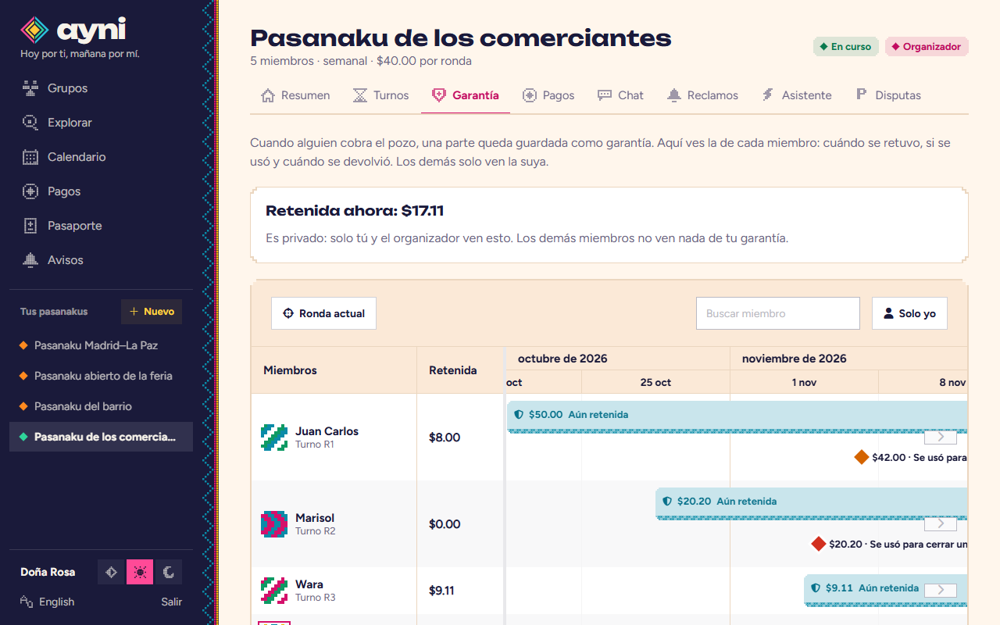<br><sub><b>Línea de tiempo de la garantía.</b> Cuándo se retuvo cada garantía, se usó para cubrir un aporte atrasado o se devolvió. Privada para el miembro y la organizadora.</sub></td>
<td width="50%">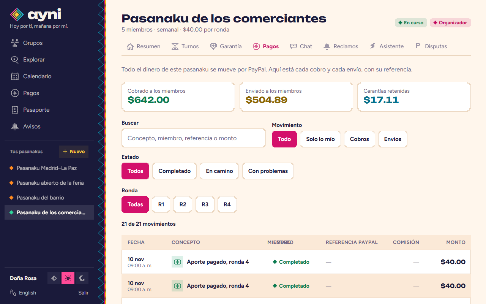<br><sub><b>Cada centavo, rastreado hasta PayPal.</b> Cobros, envíos, comisiones y referencias, con filtros. El dinero que entra es el que sale.</sub></td>
</tr>
<tr>
<td width="50%">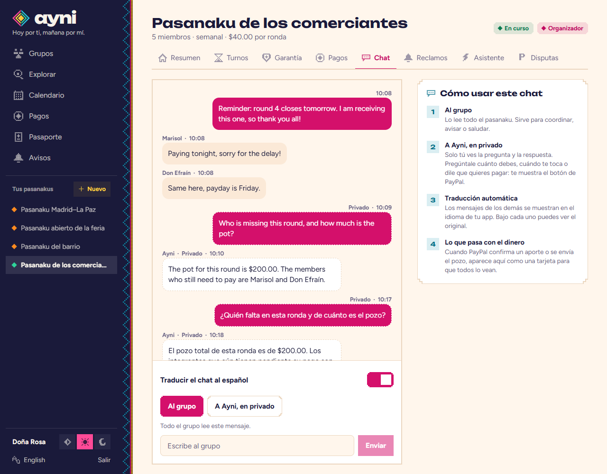<br><sub><b>Chat del grupo + asistente privado.</b> Pregunta "¿quién falta?" y recibe datos reales; la respuesta solo la ves tú.</sub></td>
<td width="50%">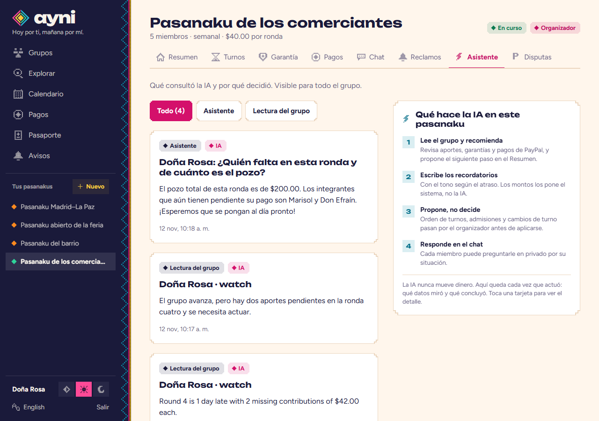<br><sub><b>Registro de la IA.</b> Qué miró, qué decidió y si vino de Claude o de las reglas de respaldo.</sub></td>
</tr>
<tr>
<td width="50%">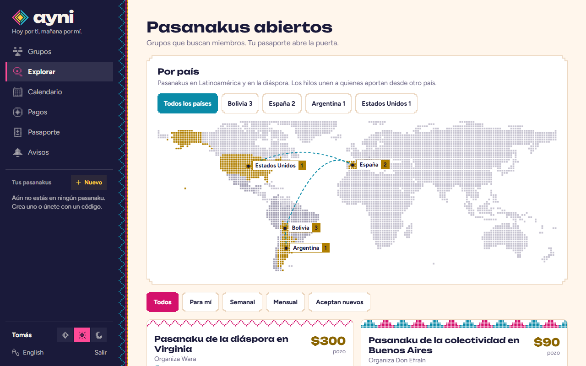<br><sub><b>Pasanakus abiertos entre desconocidos,</b> por país. Los hilos unen a miembros que pagan desde otro país.</sub></td>
<td width="50%">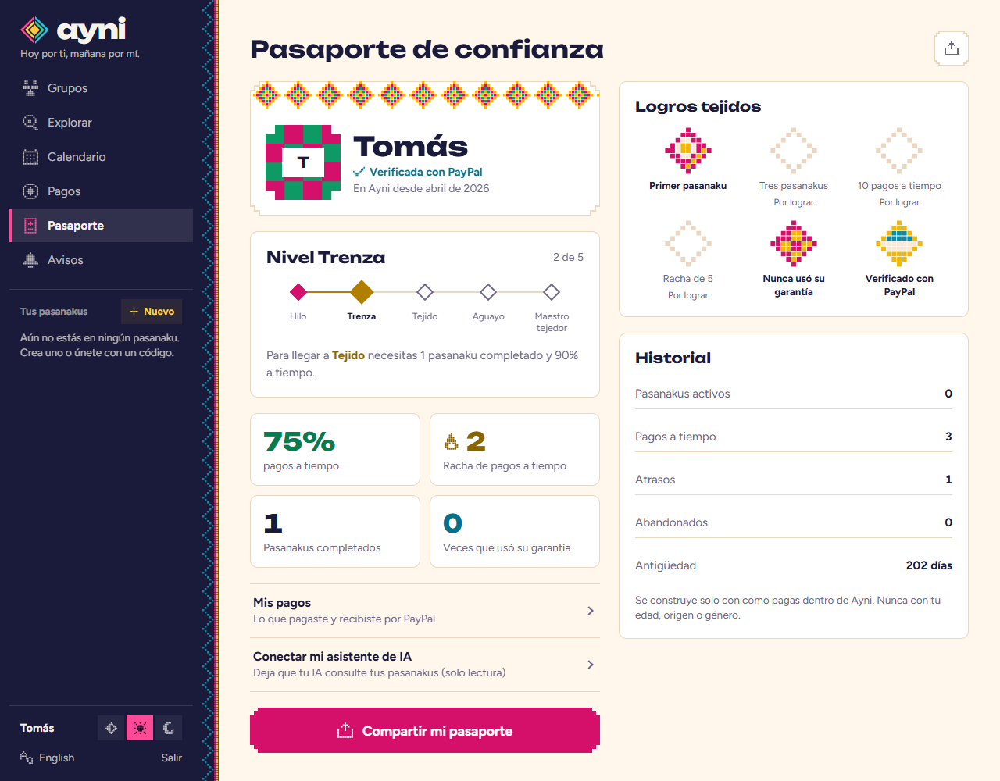<br><sub><b>Pasaporte de confianza.</b> Nivel, puntualidad, logros e historial, construidos solo con el comportamiento de pago.</sub></td>
</tr>
</table>

<table>
<tr>
<td width="33%">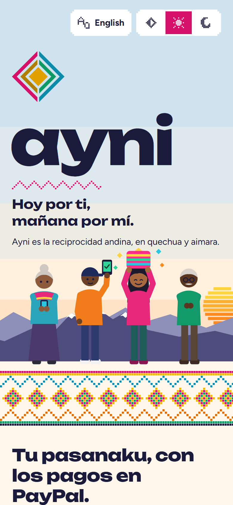</td>
<td width="33%">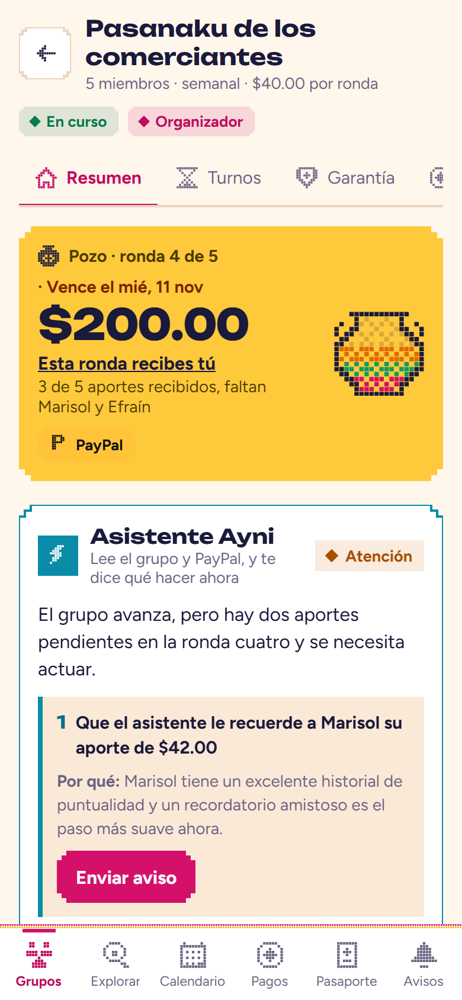</td>
<td width="33%">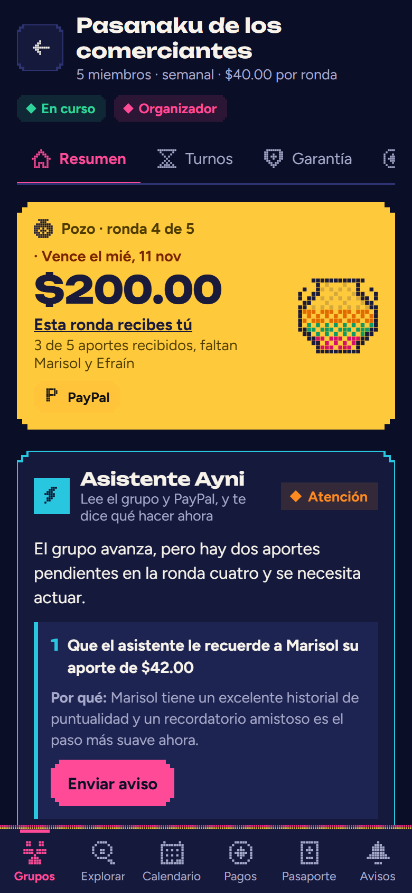</td>
</tr>
<tr>
<td align="center"><sub>App Android + web, un solo código</sub></td>
<td align="center"><sub>Pensada primero para el celular</sub></td>
<td align="center"><sub>Temas claro y oscuro</sub></td>
</tr>
</table>

---

## Cómo funciona un pasanaku

1. **Crear el pasanaku.** Aporte, frecuencia, multa por atraso y cómo se deciden los turnos (sorteo, organizadora o IA).
2. **Los miembros entran** con un código de invitación y **inician sesión con PayPal**, así Ayni sabe exactamente adónde enviar su pozo.
3. **En cada ronda**, los miembros pagan con PayPal Checkout. Cuando todos pagaron, la organizadora confirma y el pozo se envía con **PayPal Payouts**.
4. **Garantía escalonada.** Quien cobra temprano recibe ahora la mayor parte del pozo; el resto queda retenido y se devuelve cuando termina de aportar. La evaluación de riesgo de Claude mueve el porcentaje como máximo ±10 puntos.
5. **Pagos atrasados:** recordatorios cada vez más firmes escritos por Claude, una multa que va al pozo, una **factura de PayPal** en la etapa firme y, al terminar el plazo de gracia, el aporte se cubre con la propia garantía del miembro.
6. **Si alguien de verdad no paga** y ya no tiene garantía, la organizadora puede cerrar la ronda sin su aporte para que el grupo nunca quede atascado. Esa deuda se descuenta del futuro pozo de quien no pagó y **se devuelve a quienes cobraron menos**. Queda en su perfil de confianza.

### Pasanakus abiertos entre desconocidos

- **Perfil de confianza:** pasanakus completados y abandonados, % de pagos a tiempo, pagos atrasados, veces que se usó su garantía, antigüedad de la cuenta, cuenta de PayPal verificada.
- **Reglas de la organizadora:** mínimo de pasanakus completados, mínimo % a tiempo, máximo de atrasos y si acepta recién llegados.
- **Modos de admisión:** manual, automática por reglas, o **reglas + IA**: automática cuando se cumplen las reglas; en casos límite (una regla incumplida por poco) Claude explica y recomienda, y decide la organizadora.
- **Depósito de admisión:** pedir entrar coloca una **autorización** de PayPal por un aporte, que no se cobra. Si se rechaza se **anula**; si se acepta se **captura** y cuenta como su aporte de la ronda 1.
- **Recién llegados** (sin historial) siempre reciben un turno de la segunda mitad y una garantía adicional, para que construyan reputación sin poner en riesgo al grupo.

---

## Dónde se usa la IA

| Función | Qué hace Claude |
|---|---|
| Asistente del grupo | Responde "¿cuánto debo?", "¿cuándo me toca?", "¿quién falta?" con herramientas sobre datos reales del grupo, y muestra un botón *Pagar con PayPal* |
| Lectura de la ronda | Mira el estado de la ronda y propone los próximos pasos (recordar, facturar, reintentar un envío) con la razón de cada uno |
| Mediador | Atiende conflictos (no puedo pagar esta ronda, quiero cambiar de turno, disputas de PayPal), propone una opción justa y escala a la organizadora |
| Recordatorios inteligentes | Escribe recordatorios personalizados que pasan de amistosos a firmes, en el idioma del miembro |
| Orden de turnos + garantía | Propone un orden justo con una razón por miembro, según el historial de pagos; el % de garantía se ajusta por riesgo |
| Admisión | En solicitudes límite, recomienda aceptar o rechazar con una explicación en lenguaje sencillo |
| Disputas | Resume para la organizadora las disputas de PayPal sobre los aportes del grupo |
| Traducción del chat | Muestra los mensajes de los demás en tu idioma, con el original debajo |

**Seguridad por diseño: la IA puede leer y proponer, pero nunca mueve dinero.** Enviar el pozo, cambiar turnos, un orden propuesto por la IA, las admisiones y cerrar una ronda sin un aporte se convierten en *decisiones pendientes* que aprueba la organizadora. Si no responde a tiempo, la decisión se ejecuta sola, así el grupo nunca queda bloqueado.

**Transparencia.** Cada decisión de la IA se escribe en un **registro de la IA** por grupo, visible para todos: qué miró (herramientas, datos), qué decidió y si vino de Claude, de las reglas o del respaldo que se usa cuando la IA no está disponible.

**Resistencia.** Sin `ANTHROPIC_API_KEY` (o si Claude falla), cada función recurre a reglas y plantillas deterministas, y la app sigue funcionando.

**Privacidad.** Las preguntas de un miembro a Ayni y sus respuestas son privadas para ese miembro. Los mensajes de los demás se tratan como datos, nunca como instrucciones.

### Servidor MCP (solo lectura)

Un miembro puede darle a **su propio** asistente de IA (Claude u otro cliente MCP) una clave de solo lectura y preguntar "¿cuánto debo?" o "muéstrame mis pagos". `npm run mcp` en `backend/` inicia un servidor MCP por stdio con 6 herramientas de lectura (mis pasanakus, estado del pasanaku, mis pagos, historial de pagos del pasanaku, mis reclamos, mi perfil de confianza). La clave (`Pasaporte → Conectar mi asistente de IA`) solo puede hacer `GET` a una lista explícita de rutas, nunca al chat privado ni a ninguna escritura, no puede crear otras claves y se revoca al instante.

---

## También en la app

- **Historial de pagos** por pasanaku y por persona, con referencias de PayPal, la comisión de cada cobro y una tarjeta *Verificado con PayPal*.
- **Chat del grupo** con tarjetas de lo que pasó (pagó, se envió el pozo…), límite de mensajes y limpieza del texto. La autora o la organizadora pueden ocultar un mensaje.
- **Reclamos:** un miembro reporta un problema con un aporte; la organizadora lo reembolsa o lo explica. Si el miembro abre una disputa en PayPal, se une al mismo reclamo y la decisión de PayPal queda escrita ahí.
- **Aportes automáticos (PayPal Vault):** opcionales; se **avisa antes de cada cobro** y se pueden apagar en cualquier momento.
- **Conciliación diaria** con PayPal Transaction Search: los cobros registrados por Ayni se comparan con los de PayPal, y las diferencias llegan a la organizadora.

### Cronogramas con Bryntum Scheduler (web)

Tres pantallas de un pasanaku usan [Bryntum Scheduler](https://bryntum.com/products/scheduler/), una fila por miembro:

- **Cronograma de turnos:** quién cobra el pozo en cada ronda. La organizadora arrastra un turno sobre otro miembro para intercambiarlos (siempre con confirmación, validado otra vez por el servidor, solo en rondas que no empezaron).
- **Calendario de pagos:** el aporte de cada miembro a cada ronda (pagado, pendiente, atrasado…), con una estrella en quien cobra. Solo lectura.
- **Línea de tiempo de la garantía:** cuándo se retuvo, usó, devolvió o reembolsó cada garantía. Un miembro ve solo la suya; la organizadora ve la de todos.

Bryntum dibuja sobre el DOM del navegador, así que estas pantallas son solo web. La clave de licencia va en `EXPO_PUBLIC_BRYNTUM_LICENSE` (nunca se sube al repositorio; ver `app/.env.example`).

---

## Dónde se usa PayPal

PayPal no es un botón de pago agregado al final: cada movimiento de dinero en Ayni es una operación de PayPal.

| Capacidad de PayPal | Uso en Ayni |
|---|---|
| Log in with PayPal (Identity API) | Inicio de sesión, el correo verificado donde se entregan los envíos y la insignia "verificado" del perfil de confianza |
| Orders v2: crear + capturar | Cada aporte, incluidas las multas |
| Orders v2 (AUTHORIZE) + Payments v2: capturar / anular | Depósito de admisión en pasanakus abiertos |
| Payouts | Enviar el pozo, devolver garantías, compensar pozos cortos; los envíos fallidos se pueden reintentar |
| Invoicing v2 | Factura formal por aportes atrasados (se cancela sola si se paga por otra vía) |
| Disputes v1 | Disputas sobre los aportes del grupo, resumidas para la organizadora y vinculadas al reclamo del miembro por el id de la captura |
| Payments v2: reembolsos | Cancelar un pasanaku antes de empezar reembolsa los depósitos; un reclamo puede reembolsar un aporte mientras el pozo no salió; un cobro duplicado se reembolsa al instante |
| Vault v3 (método de pago guardado) | Aportes automáticos opcionales, con aviso antes de cada cobro |
| Payouts a `PAYPAL_ID` | El pozo va a la cuenta de PayPal que inició sesión, no a un correo que podría cambiar |
| Balances (reportes) | Antes de enviar un pozo se revisa el saldo de la plataforma; si PayPal dice que falta, no se envía nada |
| Transaction Search (reportes) | Conciliación diaria de cobros |
| Webhooks (firma verificada) | Capturas, reembolsos y reversos, pagos denegados, retenciones de depósito, estado de envíos (*sin reclamar* ≠ fallido), facturas pagadas, disputas, tokens de Vault |

---

## Por qué encaja con los criterios del jurado

| Criterio | Lo que aporta Ayni |
|---|---|
| **Implementación tecnológica** | 12 capacidades de PayPal en un flujo coherente, Claude con herramientas sobre datos reales, un servidor MCP de solo lectura, webhooks verificados, movimientos de dinero idempotentes y una prueba de punta a punta que verifica *dinero que entra = dinero que sale*. |
| **Diseño** | Un producto completo, no una prueba de concepto: Android + web con un solo código, temas claro y oscuro, ES/EN, una identidad tomada del tejido andino y componentes accesibles. |
| **Impacto potencial** | Una tradición real que ya mueve dinero para cientos de millones de personas, con una falla real (quien cobra primero y deja de pagar) y una forma de extenderla a familias y desconocidos entre países. |
| **Innovación / idea** | Una garantía que baja según el turno, un perfil de confianza hecho solo con el comportamiento de pago y una IA auditable por diseño: propone, las personas deciden y cada acción queda registrada. |
| **Presentación** | Una demo que cabe en menos de tres minutos: el modo demo reduce las rondas a minutos para ver en pantalla un ciclo completo (pagar, atraso, cobertura, pozo enviado). |

**Construido durante el período de presentación.** El primer commit del repositorio es del 4 de noviembre de 2026; todo lo descrito aquí se construyó después.

---

## Arquitectura

```
App Expo (Android + web)  ──►  API Node/Express (Render)  ──►  PayPal REST (sandbox)
                                   │        │
                                   │        └──►  Claude (API de Anthropic, tool use)
                                   └──►  Postgres en Neon (Prisma)
   Motor (cada 20 s): recordatorios · multas · facturas · cobertura de garantía · ejecución automática
```

- `backend/src/domain/rules.ts`: reglas puras del pasanaku (garantía escalonada, multas, riesgo, perfil de confianza, admisión, ubicación de recién llegados), con pruebas unitarias
- `backend/src/services/`: ciclo de vida del grupo, pagos, admisión, disputas, decisiones de la organizadora, motor, registro de la IA
- `backend/src/ai/agent.ts`: asistente de Claude, mediador, recordatorios, orden de turnos, resúmenes de admisión y disputas
- `backend/test/e2e.ts`: prueba de punta a punta del flujo de dinero contra un PayPal falso
- `app/src/app/`: pantallas de Expo Router

### Seguridad del dinero

- Los montos son centavos enteros. Cada regla de dinero es una función pura con pruebas.
- Cada movimiento de dinero se reclama primero con una actualización condicional, así que dobles clics, reintentos y webhooks duplicados nunca pagan dos veces. Los ids de solicitud de PayPal también son idempotentes.
- Un envío cuyo resultado se desconoce (timeout, 5xx) se marca **UNKNOWN**, no fallido, y solo se reintenta con el **mismo** `sender_batch_id`, así PayPal nunca puede pagarlo dos veces.
- Los webhooks se verifican, se deduplican por id de evento y los estados de envío nunca retroceden.
- **La IA nunca escribe montos.** Claude escribe los recordatorios con marcadores `{amount}` que el código llena. Cualquier dígito escrito por el modelo descarta el texto.
- **Dignidad dentro del grupo:** los miembros solo ven *pagado / pendiente*. Quién usó su garantía, pagó una multa o no pagó lo ven solo esa persona y la organizadora.
- La prueba de punta a punta corre un pasanaku completo con un impago, una cobertura con garantía, una respuesta perdida de PayPal y una compensación, y verifica que **dinero que entra == dinero que sale**. La integración continua la corre en cada push.

---

## 🧪 Pruébalo en dos minutos

**Demo en línea:** [RENDER_URL](RENDER_URL) (plan gratuito: la primera carga puede tardar unos 30 s mientras despierta el servidor).

En la pantalla de bienvenida hay dos etiquetas junto a los botones:

- **Usuarios** (en *Entrar a la demo*): entra como un miembro de muestra sin contraseña, para ver la app funcionando al instante.
- **Claves** (en *Ingresar con PayPal*): las cuentas de PayPal sandbox, con un botón para copiar cada correo y contraseña. Úsalas en la ventana de PayPal para pagar de verdad, en sandbox.

**Cuentas sandbox** (la misma contraseña para todas):

| Miembro | Correo | Contraseña |
|---|---|---|
| Doña Rosa | `bulk-ayni-1@personal.example.com` | `J0nhD03!` |
| Juan Carlos | `bulk-ayni-2@personal.example.com` | `J0nhD03!` |
| Marisol | `bulk-ayni-3@personal.example.com` | `J0nhD03!` |
| Don Efraín | `bulk-ayni-4@personal.example.com` | `J0nhD03!` |
| Wara | `bulk-ayni-5@personal.example.com` | `J0nhD03!` |
| Tomás | `bulk-ayni-6@personal.example.com` | `J0nhD03!` |
| Kusi | `bulk-ayni-7@personal.example.com` | `J0nhD03!` |

Al iniciar sesión en PayPal con una de estas cuentas entras como ese miembro, con sus pasanakus, historial y pasaporte. PayPal puede pedir la contraseña otra vez al pagar: es su propio inicio de sesión, aparte del de Ayni.

**Qué probar:**

| Miembro | Prueba esto |
|---|---|
| **Doña Rosa** | Organizadora de *Pasanaku del barrio* (código `BARRIO`, rondas de 4 minutos): define el orden de turnos con la IA, aprueba, inicia, envía pozos. También *Pasanaku de los comerciantes*, ya a mitad de ciclo con un pago atrasado, una garantía cubierta y una ronda abierta |
| Juan Carlos, Marisol, Don Efraín, Wara | Miembros: pagan con PayPal y conversan con el asistente ("¿cuánto debo?", "no puedo pagar esta semana") |
| **Tomás** | *Explorar* → *Pasanaku abierto de la feria*: está en el límite (75% a tiempo, el pasanaku pide 80%), así que la IA recomienda y decide **Marisol** (organizadora) |
| **Kusi** | Nuevo en Ayni: se acepta como recién llegado, con un turno de la segunda mitad y una garantía adicional |

---

## Córrelo en local

### Sin ninguna cuenta ni clave (modo simulado)

```bash
cd backend && npm install && echo APP_MODE=mock > .env && npm run dev
cd app && npm install && echo EXPO_PUBLIC_API_URL=http://localhost:4000 > .env && npx expo start --web
```

Base de datos embebida, un PayPal simulado servido por la propia API (`/__paypal`, con sus páginas de pago y un panel de todo lo "cobrado" y "enviado"), el asistente basado en reglas en vez de Claude y datos de muestra para cada pantalla. La app muestra una etiqueta **MODO SIMULADO**. Nada sale de tu computadora. `npm run mock:reset` empieza de cero.

### Con PayPal sandbox y Claude

Requisitos: Node 20+, una base de datos Postgres, una cuenta de PayPal Developer y una API key de Anthropic (opcional).

```bash
# 1. Backend
cd backend
cp .env.example .env          # completa los valores
npm install
npx prisma db push
npm run db:seed               # miembros demo, historial, pasanakus demo y un pasanaku abierto
npm run dev

# 2. App
cd ../app
cp .env.example .env          # EXPO_PUBLIC_API_URL = la URL de tu backend
npm install
npx expo start                # escanea el QR con Expo Go (Android), o pulsa "w" para web
```

Configuración de PayPal (sandbox, developer.paypal.com → Apps & Credentials → tu app):
- Activa **Log in with PayPal**, con return URL `<PUBLIC_API_URL>/auth/paypal/callback` y el alcance Email.
- Activa **Payouts**, **Invoicing** y **Disputes** en las funciones de la app.
- Agrega un webhook a `<PUBLIC_API_URL>/paypal/webhook` con estos eventos y copia su ID en `PAYPAL_WEBHOOK_ID`: `CHECKOUT.ORDER.APPROVED`, `PAYMENT.CAPTURE.COMPLETED`, `PAYMENT.PAYOUTS-ITEM.SUCCEEDED`, `PAYMENT.PAYOUTS-ITEM.FAILED`, `PAYMENT.PAYOUTS-ITEM.UNCLAIMED`, `INVOICING.INVOICE.PAID`, `CUSTOMER.DISPUTE.CREATED`, `CUSTOMER.DISPUTE.UPDATED`, `CUSTOMER.DISPUTE.RESOLVED`, `PAYMENT.CAPTURE.REFUNDED`, `PAYMENT.CAPTURE.REVERSED`, `PAYMENT.CAPTURE.DENIED`, `PAYMENT.AUTHORIZATION.VOIDED`, `VAULT.PAYMENT-TOKEN.CREATED`, `VAULT.PAYMENT-TOKEN.DELETED` y los demás estados `PAYMENT.PAYOUTS-ITEM.*`.
- Funciones opcionales que hay que habilitar en la app de PayPal: **Vault** (aportes automáticos), **Transaction Search** (conciliación diaria) y **Balances** (revisión de saldo). Sin ellas Ayni sigue funcionando: simplemente no ofrece el pago automático, la tarjeta de conciliación dice que no está disponible y se omite la revisión de saldo.
- Para mostrar las cuentas sandbox en la pantalla de bienvenida, define `ENABLE_DEMO_LOGIN=true`, `DEMO_MEMBER_EMAILS` (7 correos, en el orden de la tabla de arriba) y `DEMO_MEMBER_PASSWORD`.
- Después de traer código nuevo, corre `npx prisma db push` en `backend/` (los cambios solo agregan tablas y columnas).

PayPal debe poder llegar a `PUBLIC_API_URL`, así que usa una URL desplegada (ver `render.yaml`) o un túnel.

Pruebas:

```bash
cd backend
npm test                                                      # pruebas unitarias: reglas de dinero, libro, chat, conciliación, acceso MCP…
npm run test:mcp                                              # inicia el servidor MCP real y habla con él por el protocolo
E2E_DATABASE_URL=postgresql://.../ayni_e2e npm run test:e2e   # flujos completos, necesita una base VACÍA
npm run mock:reset && npm run dev   # luego, en otra terminal:  npm run test:smoke   (todos los endpoints, modo simulado)
```

APK de Android: `cd app && npx eas init && npx eas build -p android --profile preview` (define `EXPO_PUBLIC_API_URL` en `eas.json`). Las notificaciones push en el APK además necesitan credenciales FCM (`npx eas credentials`).

---

## Hoja de ruta

- Conciliar también los envíos (hoy la revisión diaria cubre solo los cobros)
- Registrar aportes en efectivo queda fuera a propósito: dinero fuera de PayPal rompería "dinero que entra = dinero que sale"
- Votación del grupo sobre los órdenes propuestos por la IA y un canal de WhatsApp para recordatorios
- En producción, custodiar fondos de un grupo exige licencias de transmisión de dinero; el camino sería un socio regulado o los productos de plataforma/marketplace de PayPal.

## Licencia

[MIT](LICENSE)
