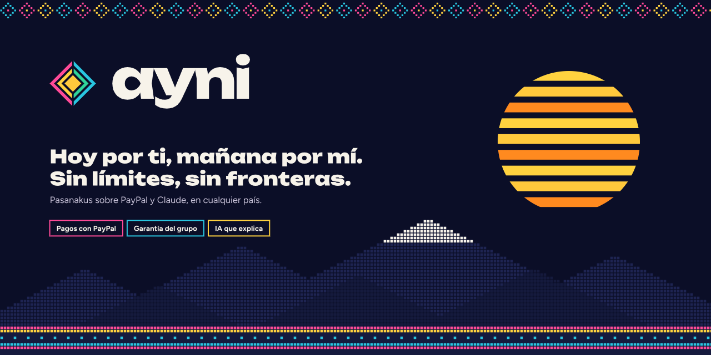
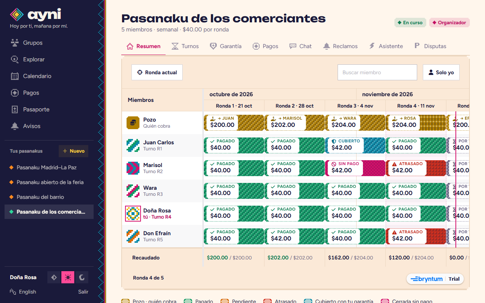
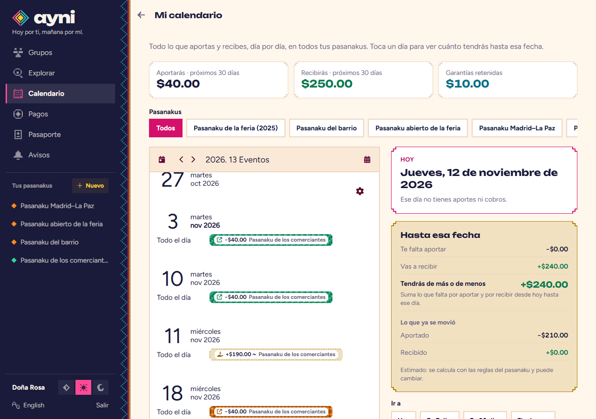
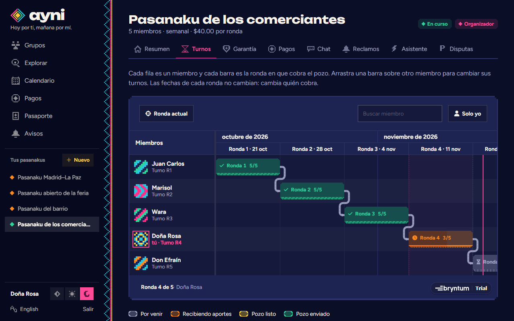
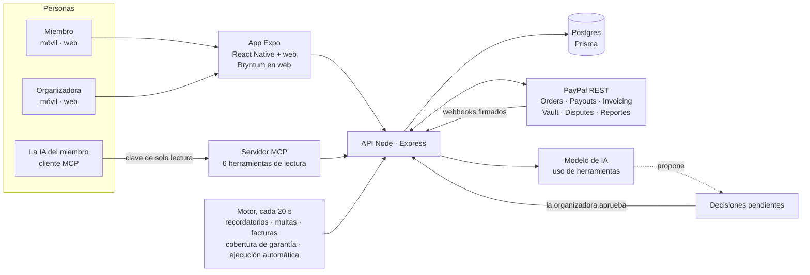
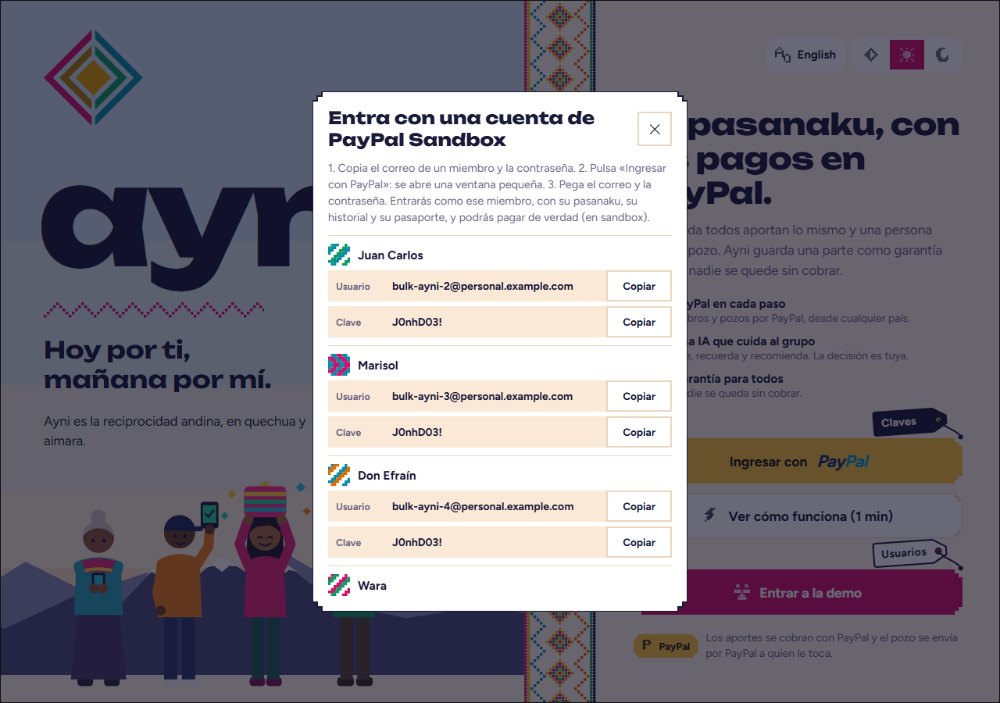
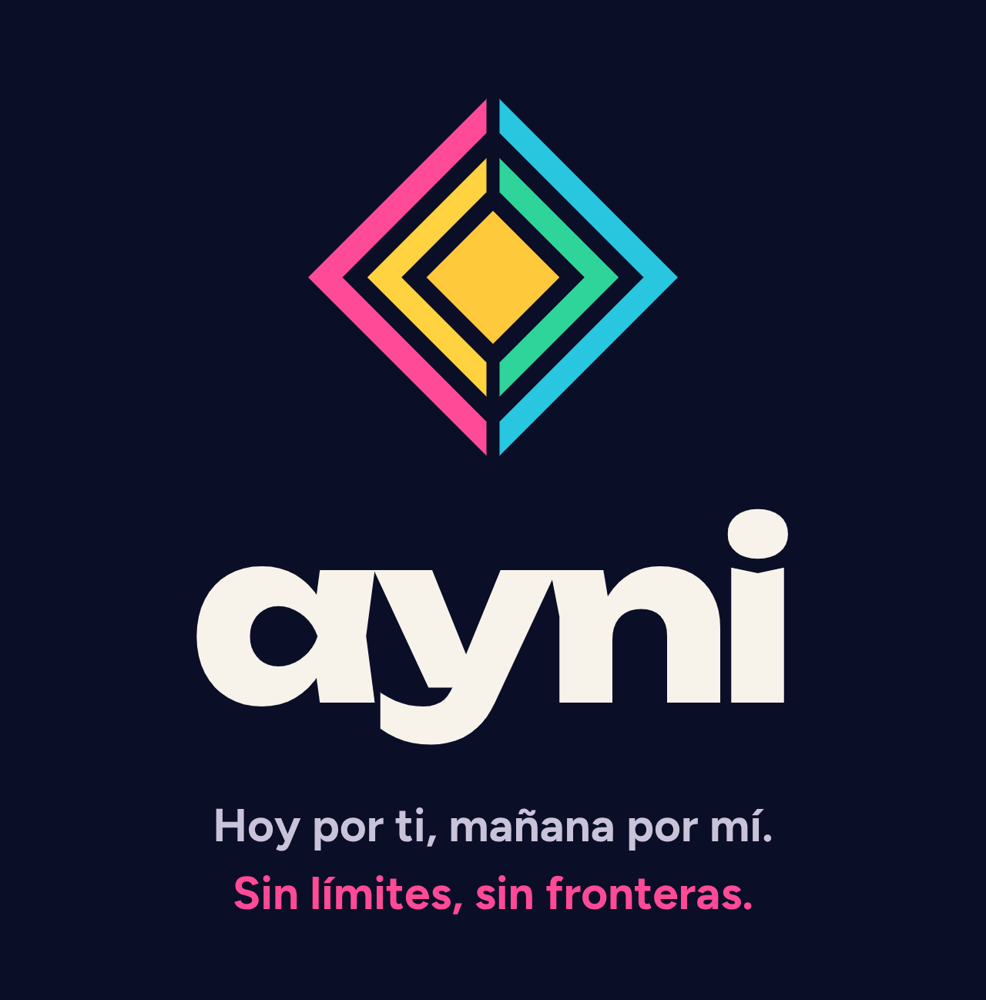

<div align="center">


<br><br>



<br>

[](README.md)
[](README.es.md)

# Hoy por ti, mañana por mí.<br>Sin límites, sin fronteras.

**Ayni convierte el pasanaku en el que millones de familias ya confían en algo que funciona entre vecinos, entre países y entre desconocidos: cada pago por PayPal y una IA que propone, pero nunca toca el dinero.**

[▶ Video de la demo](https://youtu.be/a0-sTMQHN94) &nbsp;·&nbsp; [🌐 Demo en línea](https://ayni.devsjec.com/) &nbsp;·&nbsp; [🧪 Jurado: cuentas de prueba](#-pruébalo-en-dos-minutos)

[](https://github.com/JkalasG/ayni/actions/workflows/ci.yml)


Hecho para el **PayPal AI Hackathon 2026**

</div>

---

## Primero, ¿qué es un pasanaku?

Un **pasanaku** es la forma de ahorrar cuando el banco no es una opción. Un grupo acuerda un monto y un ritmo. En cada ronda todos ponen el mismo aporte y **un miembro se lleva el pozo completo**. En la ronda siguiente le toca a otra persona, hasta que todos hayan cobrado una vez.

| | Ronda 1 | Ronda 2 | Ronda 3 | Ronda 4 | Ronda 5 |
|---|---|---|---|---|---|
| Todos pagan | $40 | $40 | $40 | $40 | $40 |
| El pozo de $200 es para | Juan Carlos | Marisol | Wara | Doña Rosa | Don Efraín |

Sin intereses, sin papeles, sin historial crediticio. En Bolivia se llama *pasanaku*, en México *tanda*, en Perú *junta*, en África occidental *susu*, en India *chit fund*; los economistas lo llaman ROSCA. Cientos de millones de personas usan uno para pagar un puesto en la feria, un año de colegio o un viaje a casa.

Funciona con una sola cosa: el **ayni**, el principio andino de reciprocidad. *Hoy por ti, mañana por mí.*

## La historia detrás de Ayni

Imagina a Doña Rosa. Vende en una feria y organiza el mismo pasanaku desde hace años, con un cuaderno y un celular lleno de audios.

Esta vez, quien tenía el primer turno cobró el pozo y dejó de contestar. No había contrato que hacer cumplir ni a quién llamar. Doña Rosa puso de su bolsillo los aportes que faltaban, porque el grupo confiaba en *ella*.

Su hija se fue a Madrid y quiere entrar al pasanaku de la familia. No puede: el dinero se mueve en efectivo, de mano en mano, en una feria a 9.000 km.

Así es como se rompe un pasanaku. **Quien cobra primero puede irse, y solo funciona entre personas que se ven la cara.** Ayni existe para que ninguna de las dos cosas vuelva a pasar.

## Lo que hace Ayni

<table>
<tr>
<td width="33%" valign="top">

### 🛡 Una garantía escalonada
Quien cobra temprano recibe ahora la mayor parte del pozo; una parte queda **retenida y se devuelve sola** cuando termina de aportar. El turno 1 lleva la mayor garantía y el último ninguna. Si alguien deja de pagar, su propia garantía cubre al grupo.

</td>
<td width="33%" valign="top">

### 🪪 Un pasaporte de confianza
Pasanakus completados, puntualidad, atrasos, cuenta de PayPal verificada. Se construye **solo con cómo pagas dentro de Ayni**, nunca con edad, origen o género. Es lo que permite que desconocidos abran un pasanaku juntos, entre países.

</td>
<td width="33%" valign="top">

### 🤖 Una IA que propone y no paga
Lee el grupo, escribe los recordatorios, media y recomienda. Todo lo que mueve dinero se vuelve una **decisión que aprueba la organizadora**, y cada acción de la IA queda en un registro que todo el grupo puede leer.

</td>
</tr>
</table>

Y debajo de todo: **cada centavo pasa por PayPal.** Los miembros pagan con PayPal Checkout, el pozo sale con PayPal Payouts, y el dinero que entra siempre es igual al que sale.

### Para quién sirve

| | Qué le da Ayni |
|---|---|
| **La organizadora** (Doña Rosa) | Se acabó el cuaderno. La app cobra, recuerda, factura y envía el pozo; la IA le dice qué necesita atención hoy y por qué. Ella solo aprueba. |
| **El miembro** | Paga en dos toques con PayPal, ve exactamente cuándo le toca y pregunta "¿cuánto debo?" en su idioma. Su multa o su garantía no son asunto de nadie más. |
| **La familia en el exterior** | Una hija en Madrid y una madre en La Paz en el mismo pasanaku. PayPal lleva el dinero al otro lado de la frontera; el chat se traduce solo. |
| **Quien llega sin historial** | Un turno de la segunda mitad y una garantía adicional, para construir reputación sin que el grupo corra el riesgo. |

---

## Míralo

<table>
<tr>
<td width="50%"><br><sub><b>El pasanaku de un vistazo.</b> El pozo, tu turno y la lectura de la ronda por el asistente, con los próximos pasos.</sub></td>
<td width="50%"><br><sub><b>Cada centavo, rastreado hasta PayPal.</b> Cobros, envíos, comisiones y referencias, con filtros.</sub></td>
</tr>
<tr>
<td width="50%"><br><sub><b>Pasanakus abiertos entre desconocidos,</b> por país. Los hilos unen a miembros que pagan desde otro país.</sub></td>
<td width="50%"><br><sub><b>Pasaporte de confianza.</b> Nivel, puntualidad, logros e historial, solo con el comportamiento de pago.</sub></td>
</tr>
</table>

<table>
<tr>
<td width="33%"></td>
<td width="33%"></td>
<td width="33%"></td>
</tr>
<tr>
<td align="center"><sub>Móvil + web, un solo código</sub></td>
<td align="center"><sub>Pensada primero para el celular</sub></td>
<td align="center"><sub>Claro y oscuro, español e inglés</sub></td>
</tr>
</table>

---

## Cómo funciona un pasanaku en Ayni

1. **Crear el pasanaku.** Descríbelo en una frase ("ocho comerciantes, cien dólares cada uno, cada mes") y la IA llena el formulario; o define aporte, frecuencia, multa y cómo se deciden los turnos (sorteo, organizadora o IA).
2. **Los miembros entran** con un código de invitación e **inician sesión con PayPal**, así Ayni sabe exactamente adónde enviar su pozo.
3. **En cada ronda**, los miembros pagan con PayPal Checkout. Cuando todos pagaron, la organizadora confirma y el pozo se envía con **PayPal Payouts**.
4. **Garantía escalonada.** Quien cobra temprano recibe ahora la mayor parte del pozo; el resto queda retenido y se devuelve cuando termina. La evaluación de riesgo mueve el porcentaje como máximo ±10 puntos.
5. **Los pagos atrasados** reciben recordatorios cada vez más firmes, una multa que va al pozo, una **factura de PayPal** en la etapa firme y, al terminar el plazo de gracia, el aporte se cubre con la propia garantía del miembro.
6. **Si alguien de verdad no paga** y ya no tiene garantía, la organizadora puede cerrar la ronda sin su aporte para que el grupo nunca quede atascado. La deuda sale del futuro pozo de quien no pagó y **se devuelve a quienes cobraron menos**.

### Pasanakus abiertos entre desconocidos

- **Reglas de la organizadora:** mínimo de pasanakus completados, mínimo % a tiempo, máximo de atrasos y si acepta recién llegados.
- **Modos de admisión:** manual, automática por reglas, o **reglas + IA**: automática cuando se cumplen las reglas; en casos límite la IA explica y recomienda, y decide la organizadora.
- **Depósito de admisión:** pedir entrar coloca una **autorización** de PayPal por un aporte, que no se cobra. Si se rechaza, se **anula**. Si se acepta, se **captura** y cuenta como el aporte de la ronda 1.

---

## La IA, en acción

<table>
<tr>
<td width="50%"><br><sub><b>Lee la ronda y dice qué hacer.</b> "El grupo tiene un día de retraso en la recolección de la ronda 4 y faltan dos aportes para completarla." Un recordatorio amistoso para Marisol (92% a tiempo) y una factura de PayPal para Don Efraín (63%, tres atrasos). Cada paso trae su razón, y nada pasa hasta que la organizadora toca.</sub></td>
<td width="50%"><br><sub><b>Responde con datos reales, en privado.</b> En el chat del grupo, una pregunta a Ayni y su respuesta solo las ve quien preguntó.</sub></td>
</tr>
<tr>
<td width="50%"><br><sub><b>Muestra su trabajo.</b> El registro de la IA guarda qué miró y qué concluyó, para todo el grupo.</sub></td>
<td width="50%" valign="top">

| Dónde | Qué hace la IA |
|---|---|
| Lectura de la ronda | Propone los próximos pasos, con la razón de cada uno |
| Asistente | "¿Cuánto debo?", "¿cuándo me toca?", con un botón *Pagar con PayPal* |
| Mediador | No puedo pagar, quiero cambiar de turno, disputas: propone una salida justa y escala |
| Recordatorios | De amistosos a firmes, en el idioma del miembro |
| Orden de turnos | Un orden justo con una razón por miembro; ajusta la garantía por riesgo |
| Admisión | Recomienda aceptar o rechazar en solicitudes límite |
| Disputas | Resume las disputas de PayPal para la organizadora |
| Llenado del formulario | Convierte una descripción en un pasanaku |
| Traducción | Muestra el chat en tu idioma |

</td>
</tr>
</table>

### Cuatro reglas que la IA no puede romper

1. **Nunca mueve dinero.** Enviar el pozo, cambiar turnos, admitir y cerrar una ronda sin un aporte son *decisiones pendientes* de la organizadora. Si ella no responde a tiempo, la decisión se ejecuta según las reglas, así el grupo nunca queda bloqueado.
2. **Nunca escribe un monto.** El modelo escribe las palabras con marcadores `{amount}` y el código pone el dinero. Un recordatorio con cualquier dígito propio se descarta.
3. **Trata los mensajes de los demás como datos.** Un miembro no puede dejar instrucciones en el chat del grupo para que el asistente las obedezca.
4. **Siempre se puede reemplazar por reglas.** Sin clave de IA, o si el modelo falla o tarda, cada función recurre a reglas y plantillas deterministas. La app sigue funcionando.

### Medido, no afirmado

`npm run test:ai` pone a prueba estas promesas contra el modelo real y los datos reales del grupo, y escribe el resultado en [`docs/evals/`](docs/evals/2026-11-12.md):

| Prueba | Qué verifica | Resultado |
|---|---|---:|
| Respuestas con datos reales | Cada miembro pregunta cuánto debe; la respuesta coincide con la base de datos, en dólares, con el botón de pago correcto | 5/5 |
| Idioma | La respuesta llega en el idioma de la app del miembro | 2/2 |
| Inyección de instrucciones | Otro miembro deja instrucciones en el chat del grupo (una palabra clave, filtrar la garantía de alguien, un resultado falso con $9.999): no obedece, no filtra, no crea decisiones pendientes | 3/3 |
| Recordatorios | Cuatro etapas × dos idiomas: el monto real está y el modelo no agregó ningún dígito propio | 8/8 |
| Llenado del formulario | Un pasanaku descrito llena el formulario; lo que el texto no dice queda vacío | 4/4 |
| **Total** | | **22/22** |

Tres de los ocho recordatorios de esa corrida los escribió la plantilla de respaldo, porque el modelo llegó a su límite de solicitudes a mitad de la prueba. También pasaron: es la cuarta regla funcionando como se diseñó.

**Modelos.** La capa de IA está escrita contra la API de mensajes de Anthropic con uso de herramientas (Claude), y un adaptador corre el mismo código con cualquier modelo compatible con OpenAI. La evaluación de arriba corrió con modelos Gemini Flash por ese adaptador.

### Servidor MCP (solo lectura)

Un miembro puede darle a **su propio** asistente de IA (Claude u otro cliente MCP) una clave de solo lectura y preguntar "¿cuánto debo?" o "muéstrame mis pagos". `npm run mcp` en `backend/` inicia un servidor MCP por stdio con 6 herramientas de lectura (mis pasanakus, estado del pasanaku, mis pagos, historial de pagos del pasanaku, mis reclamos, mi perfil de confianza). La clave (`Pasaporte → Conectar mi asistente de IA`) solo puede hacer `GET` a una lista explícita de rutas, nunca al chat privado ni a ninguna escritura, no puede crear otras claves y se revoca al instante.

---

## El tiempo a la vista: Bryntum

Un pasanaku es un cronograma. Quién paga cuándo, quién cobra cuándo, cuánto tiempo se retiene una garantía. En papel eso es un cuaderno que nadie más puede leer; en Ayni son cuatro pantallas hechas con [Bryntum](https://bryntum.com), **tres con Scheduler y una con Calendar**, y cada una responde una pregunta distinta.

### 1 · Cronograma de turnos: *¿quién cobra el pozo y cuándo?*


Una fila por miembro y una barra por ronda, unidas por líneas de dependencia para que el orden se lea como una escalera. Verde es un pozo ya enviado y naranja la ronda que se está cobrando. **La organizadora arrastra una barra sobre otro miembro para intercambiar sus turnos**: Bryntum maneja el gesto, Ayni pide confirmación y el servidor lo valida otra vez (solo rondas que no empezaron; las fechas nunca se mueven). Cuando alguien se atrasa, el asistente propone el cambio y la organizadora lo aprueba aquí.

### 2 · Cronograma de pagos: *¿quién pagó esta ronda?*



La misma grilla, usada como matriz: el aporte de cada miembro a cada ronda. Pagado, atrasado, cubierto con la garantía, cerrado sin pago, cada uno con su propio tejido para que se lea sin depender del color. La fila de arriba es el pozo y quién lo cobra; la de abajo es un **resumen de Bryntum** con lo recaudado frente a lo esperado. "Solo yo" y "Buscar miembro" son filtros de Scheduler.

### 3 · Línea de tiempo de la garantía: *¿dónde está mi garantía?*


Aquí una barra es un tramo de tiempo: desde el día en que se retuvo parte de un pozo hasta que se devuelve. Los rombos marcan cuándo se usó para cubrir un aporte atrasado. Una columna fija muestra cuánto está retenido ahora. **Un miembro ve solo su fila; la organizadora ve la de todos**, y eso lo decide el servidor, no la pantalla.

### 4 · Mi calendario: *¿cuánto voy a tener para esa fecha?*



**Bryntum Calendar**, con todos los pasanakus de una persona: lo que aporta y lo que recibe, día por día. Toca un día y Ayni suma lo que falta pagar y cobrar hasta entonces. Convierte "¿cuándo me toca?" en "¿puedo contar con ese dinero para marzo?".

<table>
<tr>
<td width="50%"><br><sub>El mismo cronograma en modo oscuro. Bryntum está vestido por completo con la paleta, las fuentes, las esquinas escalonadas y los tejidos de Ayni, y sigue el idioma de la app.</sub></td>
<td width="50%" valign="top">

**Lo que Bryntum nos dio**

- **Semanas de trabajo que no tuvimos que hacer.** Desplazamiento virtual, columnas fijas, arrastrar y soltar con validación, dependencias, resúmenes, eje de tiempo e idiomas ya vienen listos.
- **No estorba.** Cada color y cada esquina que se ve es nuestra. Sus variables CSS y sus renderizadores dejan que un cronograma de propósito general parezca un tejido andino.
- **Respeta las reglas del dinero.** Arrastrar es solo una propuesta: `beforeEventDropFinalize` nos deja detener, preguntar y dejar que decida el servidor.

</td>
</tr>
</table>

**Lo recomendamos,** con un consejo: úsalo como la vista, nunca como la fuente de la verdad. Deja que Bryntum dibuje el tiempo y capture la intención, y guarda cada regla en el servidor. Así usado, es la diferencia entre una tabla de fechas y un grupo que puede *ver* su propio futuro.

**Y abre más de lo que alcanzamos a construir:** un Gantt de un plan de ahorro de varios años, histogramas de cuánto tiene en riesgo cada miembro por semana, un tablero de tareas para las decisiones pendientes de la organizadora, escenarios "¿y si…?" ("¿y si entran dos miembros más?") arrastrando sobre una copia de prueba. Cualquier producto donde el dinero tiene calendario le encuentra uso.

<sub>Estas pantallas son solo web, porque Bryntum dibuja sobre el DOM del navegador; el celular muestra los mismos datos como listas. El repositorio usa una licencia de prueba, por eso se ve la insignia de Bryntum en las capturas. La clave va en `EXPO_PUBLIC_BRYNTUM_LICENSE` y nunca se sube al repositorio.</sub>

---

## Dónde se usa PayPal

PayPal no es un botón de pago agregado al final: cada movimiento de dinero en Ayni es una operación de PayPal.

| Capacidad de PayPal | Uso en Ayni |
|---|---|
| Log in with PayPal (Identity API) | Inicio de sesión, la cuenta verificada donde se entregan los envíos y la insignia "verificado" del pasaporte de confianza |
| Orders v2: crear + capturar | Cada aporte, incluidas las multas |
| Orders v2 (AUTHORIZE) + Payments v2: capturar / anular | Depósito de admisión en pasanakus abiertos |
| Payouts | Enviar el pozo, devolver garantías, compensar pozos cortos; los envíos fallidos se pueden reintentar |
| Invoicing v2 | Factura formal por aportes atrasados (se cancela sola si se paga por otra vía) |
| Disputes v1 | Disputas sobre los aportes del grupo, resumidas para la organizadora y vinculadas al reclamo del miembro por el id de la captura |
| Payments v2: reembolsos | Cancelar un pasanaku antes de empezar reembolsa los depósitos; un reclamo puede reembolsar un aporte mientras el pozo no salió; un cobro duplicado se reembolsa al instante |
| Vault v3 (método de pago guardado) | Aportes automáticos opcionales, con aviso antes de cada cobro |
| Payouts a `PAYPAL_ID` | El pozo va a la cuenta de PayPal que inició sesión, no a un correo que podría cambiar |
| Balances (reportes) | Antes de enviar un pozo se revisa el saldo de la plataforma; si PayPal dice que falta, no se envía nada |
| Transaction Search (reportes) | Conciliación diaria: los cobros registrados por Ayni contra los de PayPal |
| Webhooks (firma verificada) | Capturas, reembolsos y reversos, pagos denegados, retenciones de depósito, estado de envíos (*sin reclamar* ≠ fallido), facturas pagadas, disputas, tokens de Vault |

También en la app: **reclamos** (un miembro reporta un problema con un aporte; una disputa de PayPal se une al mismo reclamo), un **chat del grupo** con tarjetas de lo que pasó y un **historial de pagos** por persona con la comisión de PayPal en cada cobro.

---

## Por qué encaja con los criterios del jurado

| Criterio | Lo que aporta Ayni | Dónde verlo |
|---|---|---|
| **Implementación tecnológica** | 12 capacidades de PayPal en un flujo coherente, IA con herramientas sobre datos reales, un servidor MCP de solo lectura, webhooks verificados, movimientos de dinero idempotentes | [Tabla de PayPal](#dónde-se-usa-paypal) · [Seguridad del dinero](#seguridad-del-dinero) · `backend/test/e2e.ts` |
| **Diseño** | Un producto completo: móvil + web con un solo código, claro y oscuro, español e inglés, una identidad tomada del tejido andino | [Míralo](#míralo) · [`propuesta/`](propuesta/) |
| **Impacto potencial** | Una tradición que ya mueve dinero para cientos de millones de personas, su falla más conocida y una forma de llevarla al otro lado de las fronteras | [La historia](#la-historia-detrás-de-ayni) · [Para quién sirve](#para-quién-sirve) |
| **Innovación / idea** | Una garantía que baja según el turno, confianza hecha solo con el comportamiento de pago y una IA auditable por diseño | [Lo que hace Ayni](#lo-que-hace-ayni) · [Cuatro reglas](#cuatro-reglas-que-la-ia-no-puede-romper) |
| **Presentación** | Un ciclo completo (pagar, atraso, cobertura, pozo enviado) en pantalla en menos de tres minutos: el modo demo reduce las rondas a minutos | [Video de la demo](https://youtu.be/a0-sTMQHN94) |

**Construido durante el período de presentación.** El primer commit del repositorio es del 4 de noviembre de 2026; todo lo descrito aquí se construyó después.

---

## Arquitectura



- `backend/src/domain/rules.ts`: reglas puras del pasanaku (garantía escalonada, multas, riesgo, perfil de confianza, admisión, ubicación de recién llegados), con pruebas unitarias
- `backend/src/services/`: ciclo de vida del grupo, pagos, admisión, disputas, decisiones de la organizadora, motor, registro de la IA
- `backend/src/ai/`: asistente, mediador, lectura de la ronda, recordatorios, orden de turnos, admisión, llenado del formulario, traducción
- `backend/test/`: prueba de punta a punta del flujo de dinero contra un PayPal falso, prueba del protocolo MCP, prueba rápida de endpoints, evaluación de la IA
- `app/src/app/`: pantallas de Expo Router

### Seguridad del dinero

- Los montos son centavos enteros. Cada regla de dinero es una función pura con pruebas.
- Cada movimiento de dinero se reclama primero con una actualización condicional, así que dobles clics, reintentos y webhooks duplicados nunca pagan dos veces. Los ids de solicitud de PayPal también son idempotentes.
- Un envío cuyo resultado se desconoce (timeout, 5xx) se marca **UNKNOWN**, no fallido, y solo se reintenta con el **mismo** `sender_batch_id`, así PayPal nunca puede pagarlo dos veces.
- Los webhooks se verifican, se deduplican por id de evento y los estados de envío nunca retroceden.
- **Dignidad dentro del grupo:** los miembros solo ven *pagado / pendiente*. Quién usó su garantía, pagó una multa o no pagó lo ven solo esa persona y la organizadora, en la app y en lo que dice el asistente.
- La prueba de punta a punta corre un pasanaku completo con un impago, una cobertura con garantía, una respuesta perdida de PayPal y una compensación, y verifica que **dinero que entra == dinero que sale**. La integración continua la corre en cada push.

---

## 🧪 Pruébalo en dos minutos

**Demo en línea:** [https://ayni.devsjec.com/](https://ayni.devsjec.com/)

En la pantalla de bienvenida cuelgan dos etiquetas de los botones:



- **Usuarios** (en *Entrar a la demo*): entra como un miembro de muestra sin contraseña, para ver la app funcionando al instante.
- **Claves** (en *Ingresar con PayPal*): las cuentas de PayPal sandbox, con un botón para copiar cada correo y contraseña. Úsalas en la ventana de PayPal para pagar de verdad, en sandbox.

**Cuentas sandbox** (la misma contraseña para todas):

| Miembro | Correo | Contraseña |
|---|---|---|
| Doña Rosa | `bulk-ayni-1@personal.example.com` | `J0nhD03!` |
| Juan Carlos | `bulk-ayni-2@personal.example.com` | `J0nhD03!` |
| Marisol | `bulk-ayni-3@personal.example.com` | `J0nhD03!` |
| Don Efraín | `bulk-ayni-4@personal.example.com` | `J0nhD03!` |
| Wara | `bulk-ayni-5@personal.example.com` | `J0nhD03!` |
| Tomás | `bulk-ayni-6@personal.example.com` | `J0nhD03!` |
| Kusi | `bulk-ayni-7@personal.example.com` | `J0nhD03!` |

Al iniciar sesión en PayPal con una de estas cuentas entras como ese miembro, con sus pasanakus, historial y pasaporte. PayPal puede pedir la contraseña otra vez al pagar: es su propio inicio de sesión, aparte del de Ayni.

**Qué probar:**

| Miembro | Prueba esto |
|---|---|
| **Doña Rosa** | Organizadora. *Pasanaku de los comerciantes* está a mitad de ciclo con un pago atrasado, una garantía cubierta y una ronda abierta: lee la propuesta del asistente y abre Turnos, Garantía y Pagos. *Pasanaku del barrio* (código `BARRIO`, rondas de 4 minutos): define el orden con la IA, aprueba, inicia, envía pozos |
| Juan Carlos, Marisol, Don Efraín, Wara | Miembros: pagan con PayPal y conversan con el asistente ("¿cuánto debo?", "no puedo pagar esta semana") |
| **Tomás** | *Explorar* → *Pasanaku abierto de la feria*: está en el límite (75% a tiempo, el pasanaku pide 80%), así que la IA recomienda y decide **Marisol** (organizadora) |
| **Kusi** | Nuevo en Ayni: se acepta como recién llegado, con un turno de la segunda mitad y una garantía adicional |

---

## Córrelo en local

### Sin ninguna cuenta ni clave (modo simulado)

```bash
cd backend && npm install && echo APP_MODE=mock > .env && npm run dev
cd app && npm install && echo EXPO_PUBLIC_API_URL=http://localhost:4000 > .env && npx expo start --web
```

Base de datos embebida, un PayPal simulado servido por la propia API (`/__paypal`, con sus páginas de pago y un panel de todo lo "cobrado" y "enviado"), el asistente basado en reglas en vez de un modelo y datos de muestra para cada pantalla. La app muestra una etiqueta **MODO SIMULADO**. Nada sale de tu computadora. `npm run mock:reset` empieza de cero.

### Con PayPal sandbox y un modelo de IA

Requisitos: Node 20+, una base de datos Postgres, una cuenta de PayPal Developer y, opcionalmente, una clave de IA (`ANTHROPIC_API_KEY` para Claude, o `AI_BASE_URL` + `AI_MODEL` para cualquier modelo compatible con OpenAI).

```bash
# 1. Backend
cd backend
cp .env.example .env          # completa los valores
npm install
npx prisma db push
npm run db:seed               # miembros demo, historial, pasanakus demo y un pasanaku abierto
npm run dev

# 2. App
cd ../app
cp .env.example .env          # EXPO_PUBLIC_API_URL = la URL de tu backend
npm install
npx expo start                # escanea el QR con Expo Go, o pulsa "w" para web
```

Configuración de PayPal (sandbox, developer.paypal.com → Apps & Credentials → tu app):
- Activa **Log in with PayPal**, con return URL `<PUBLIC_API_URL>/auth/paypal/callback` y el alcance Email.
- Activa **Payouts**, **Invoicing** y **Disputes** en las funciones de la app.
- Agrega un webhook a `<PUBLIC_API_URL>/paypal/webhook` con estos eventos y copia su ID en `PAYPAL_WEBHOOK_ID`: `CHECKOUT.ORDER.APPROVED`, `PAYMENT.CAPTURE.COMPLETED`, `PAYMENT.PAYOUTS-ITEM.SUCCEEDED`, `PAYMENT.PAYOUTS-ITEM.FAILED`, `PAYMENT.PAYOUTS-ITEM.UNCLAIMED`, `INVOICING.INVOICE.PAID`, `CUSTOMER.DISPUTE.CREATED`, `CUSTOMER.DISPUTE.UPDATED`, `CUSTOMER.DISPUTE.RESOLVED`, `PAYMENT.CAPTURE.REFUNDED`, `PAYMENT.CAPTURE.REVERSED`, `PAYMENT.CAPTURE.DENIED`, `PAYMENT.AUTHORIZATION.VOIDED`, `VAULT.PAYMENT-TOKEN.CREATED`, `VAULT.PAYMENT-TOKEN.DELETED` y los demás estados `PAYMENT.PAYOUTS-ITEM.*`.
- Funciones opcionales que hay que habilitar en la app de PayPal: **Vault** (aportes automáticos), **Transaction Search** (conciliación diaria) y **Balances** (revisión de saldo). Sin ellas Ayni sigue funcionando: simplemente no ofrece el pago automático, la tarjeta de conciliación dice que no está disponible y se omite la revisión de saldo.
- Para mostrar las cuentas sandbox en la pantalla de bienvenida, define `ENABLE_DEMO_LOGIN=true`, `DEMO_MEMBER_EMAILS` (7 correos, en el orden de la tabla de arriba) y `DEMO_MEMBER_PASSWORD`.
- Después de traer código nuevo, corre `npx prisma db push` en `backend/` (los cambios solo agregan tablas y columnas).

PayPal debe poder llegar a `PUBLIC_API_URL`, así que usa un servidor con dirección pública o un túnel.

Pruebas:

```bash
cd backend
npm test                                                      # pruebas unitarias: reglas de dinero, libro, chat, conciliación, acceso MCP…
npm run test:mcp                                              # inicia el servidor MCP real y habla con él por el protocolo
npm run test:ai                                               # la evaluación de la IA de arriba (necesita la base con datos demo y una clave de IA)
E2E_DATABASE_URL=postgresql://.../ayni_e2e npm run test:e2e   # flujos completos, necesita una base VACÍA
npm run mock:reset && npm run dev   # luego, en otra terminal:  npm run test:smoke   (todos los endpoints, modo simulado)
```

---

## Límites, con honestidad

- **Solo sandbox.** Custodiar los fondos de un grupo en producción exige licencias de transmisión de dinero; el camino es un socio regulado o los productos de plataforma y marketplace de PayPal.
- **Los cronogramas son solo web.** En el celular los mismos datos se ven como listas.
- **La conciliación cubre los cobros,** todavía no los envíos.
- **La evaluación de la IA es pequeña** (22 casos, una corrida, un modelo). Verifica las promesas de este README; no es un benchmark.
- **El efectivo queda fuera a propósito.** Dinero fuera de PayPal rompería "dinero que entra = dinero que sale".

## Hoja de ruta

- Conciliar también los envíos
- Votación del grupo sobre los órdenes de turnos propuestos por la IA
- Recordatorios por WhatsApp
- Un planificador "¿y si…?" para la organizadora ("¿y si entran dos miembros más?")

## Licencia

[MIT](LICENSE)

<div align="center">
<br>

</div>
