<div align="center">

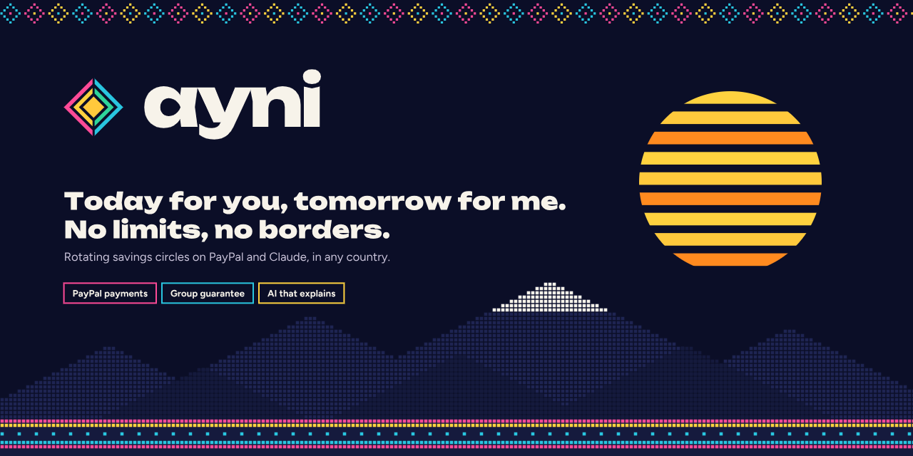

<br>

[](README.md)
[](README.es.md)

# Today for you, tomorrow for me.<br>No limits, no borders.

**Ayni turns the savings circle that millions of families already trust into something that works between neighbors, between countries and between strangers: every payment on PayPal, and an AI that proposes but never touches the money.**

[▶ Demo video](YOUTUBE_URL) &nbsp;·&nbsp; [🌐 Live demo](DEMO_URL) &nbsp;·&nbsp; [📱 Android APK](APK_URL) &nbsp;·&nbsp; [🧪 Judges: test accounts](#-try-it-in-two-minutes)

[](https://github.com/JkalasG/ayni/actions/workflows/ci.yml)


Built for the **PayPal AI Hackathon 2026**

</div>

---

## First, what is a pasanaku?

A **pasanaku** is how people save when the bank is not an option. A group agrees on an amount and a rhythm. Every round, everyone puts in the same contribution, and **one member takes the whole pot**. The next round it is someone else's turn, until everyone has received once.

| | Round 1 | Round 2 | Round 3 | Round 4 | Round 5 |
|---|---|---|---|---|---|
| Everyone pays | $40 | $40 | $40 | $40 | $40 |
| The $200 pot goes to | Juan Carlos | Marisol | Wara | Doña Rosa | Don Efraín |

No interest, no paperwork, no credit score. In Bolivia it is called *pasanaku*, in Mexico *tanda*, in Peru *junta*, in West Africa *susu*, in India *chit fund*; economists call it a ROSCA. Hundreds of millions of people use one to pay for a stall at the market, a school year, a trip home.

It runs on one thing: **ayni**, the Andean principle of reciprocity. *Today for you, tomorrow for me.*

## The story behind Ayni

Picture Doña Rosa. She sells at a street market and has organized the same pasanaku for years, with a notebook and a phone full of voice messages.

This time the person with the first turn took the pot and stopped answering. There was no contract to enforce and nobody to call. Doña Rosa covered the missing contributions from her own pocket, because the group trusted *her*.

Her daughter moved to Madrid and wants to join the family circle. She cannot: the money moves in cash, hand to hand, in a market 9,000 km away.

Those are the two ways a pasanaku breaks. **Whoever is paid first can walk away, and it only works among people who can see each other.** Ayni exists so neither of them happens again.

## What Ayni does about it

<table>
<tr>
<td width="33%" valign="top">

### 🛡 A guarantee that tapers
Whoever receives early gets most of the pot now; a part is **withheld and returned automatically** when they finish contributing. Turn #1 carries the largest guarantee, the last turn none. If someone stops paying, their own guarantee covers the group.

</td>
<td width="33%" valign="top">

### 🪪 A trust passport
Completed circles, on-time rate, late payments, PayPal-verified account. Built **only from how you pay inside Ayni**, never from age, origin or gender. It is what lets strangers open a circle together, across countries.

</td>
<td width="33%" valign="top">

### 🤖 An AI that proposes, never pays
It reads the group, writes the reminders, mediates and recommends. Anything that moves money becomes a **decision the organizer approves**, and every AI action is written to a log the whole group can read.

</td>
</tr>
</table>

And underneath all of it: **every cent moves through PayPal.** Members pay with PayPal Checkout, the pot leaves with PayPal Payouts, and the money that comes in always equals the money that goes out.

### Who it is for

| | What Ayni gives them |
|---|---|
| **The organizer** (Doña Rosa) | No more notebook. The app collects, reminds, invoices and sends the pot; the AI tells her what needs attention today and why. She only approves. |
| **The member** | Pay in two taps with PayPal, see exactly when your turn comes, and ask "how much do I owe?" in your own language. Your late fee or your guarantee is nobody else's business. |
| **The family abroad** | A daughter in Madrid and a mother in La Paz in the same circle. PayPal carries the money across the border; the chat translates itself. |
| **The newcomer with no history** | A second-half turn and an extra guarantee, so they can build a reputation without the group taking the risk. |

---

## See it

<table>
<tr>
<td width="50%">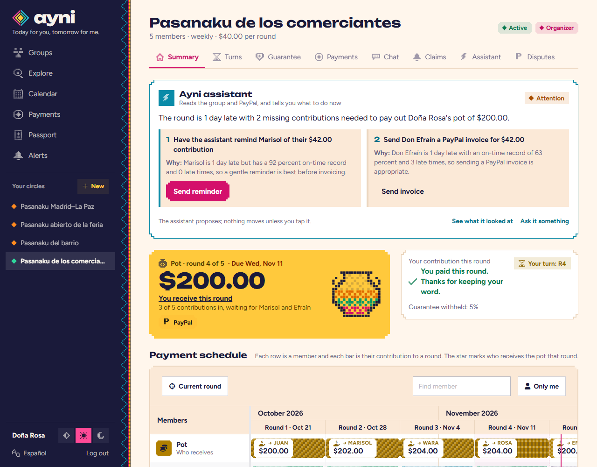<br><sub><b>The circle at a glance.</b> The pot, your turn, and the assistant's reading of the round with the next steps.</sub></td>
<td width="50%">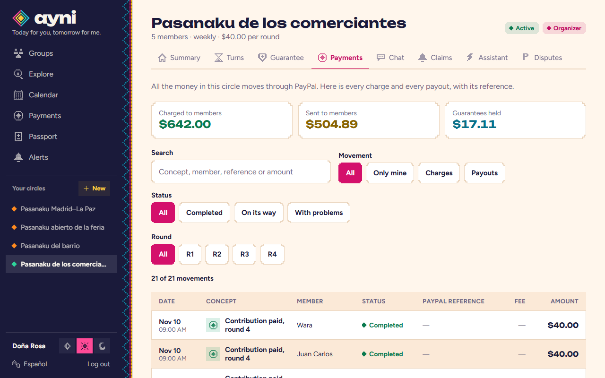<br><sub><b>Every cent, traced to PayPal.</b> Charges, payouts, fees and references, with filters.</sub></td>
</tr>
<tr>
<td width="50%">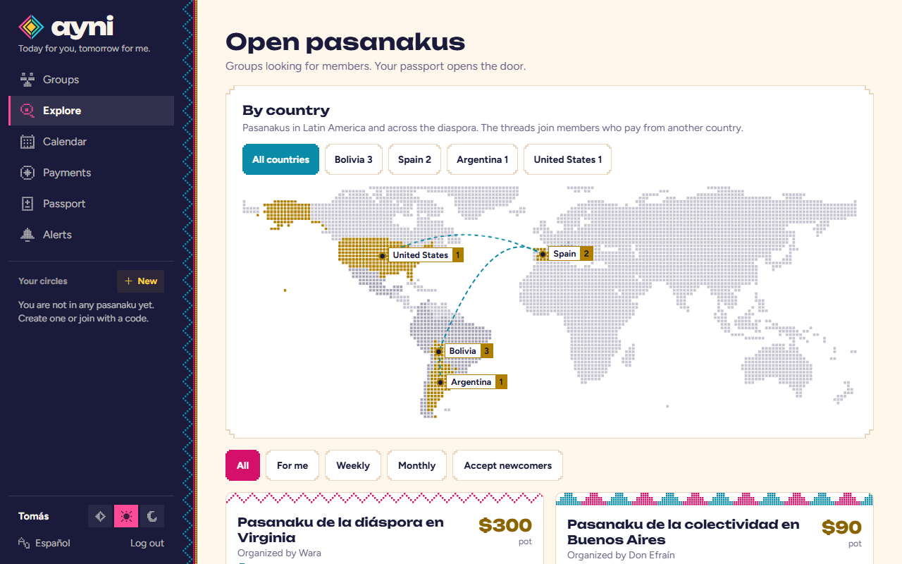<br><sub><b>Open circles between strangers,</b> by country. The threads join members who pay from another country.</sub></td>
<td width="50%">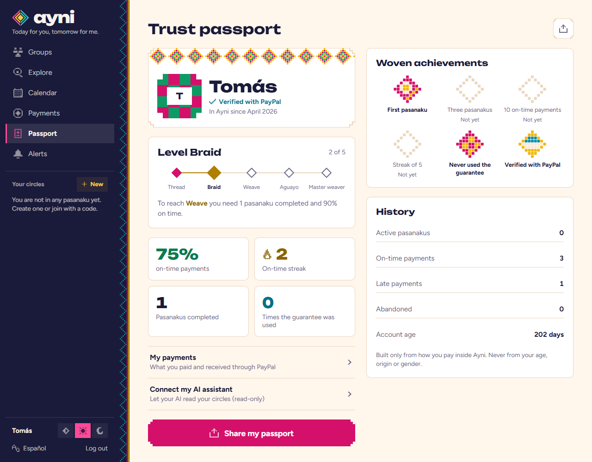<br><sub><b>Trust passport.</b> Level, on-time rate, achievements and history, from payment behavior only.</sub></td>
</tr>
</table>

<table>
<tr>
<td width="33%">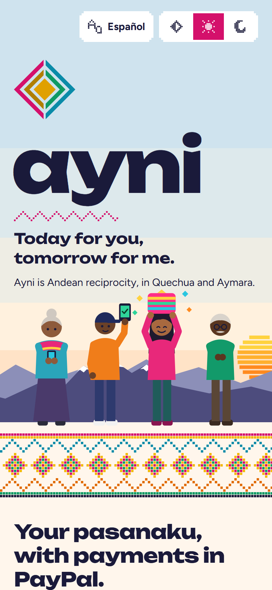</td>
<td width="33%">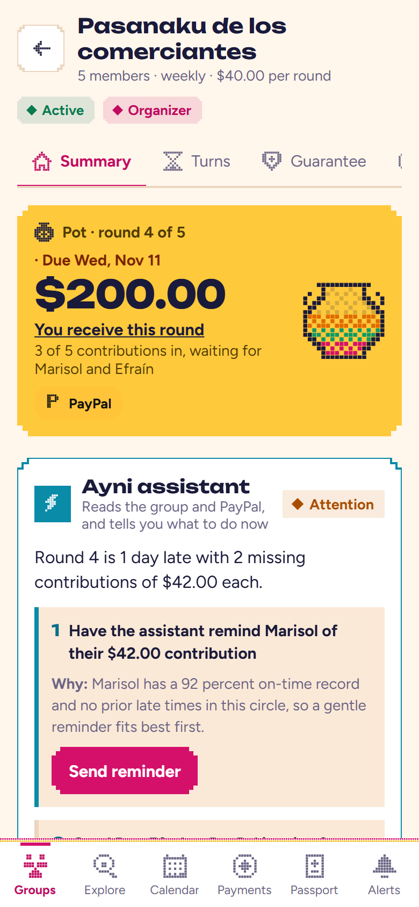</td>
<td width="33%">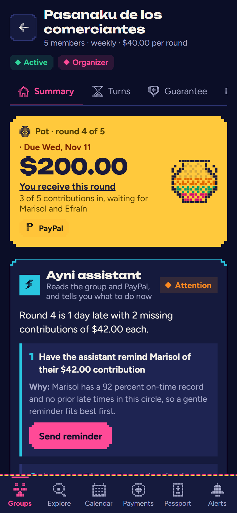</td>
</tr>
<tr>
<td align="center"><sub>Android app + web, one codebase</sub></td>
<td align="center"><sub>Built for the phone first</sub></td>
<td align="center"><sub>Light and dark, English and Spanish</sub></td>
</tr>
</table>

---

## How a circle works

1. **Create a circle.** Describe it in a sentence ("eight vendors, a hundred dollars each, every month") and the AI fills the form; or set contribution, frequency, late fee and how turns are decided (lottery, organizer, or AI).
2. **Members join** with an invite code and **log in with PayPal**, so Ayni knows exactly where to send their pot.
3. **Each round**, members pay with PayPal Checkout. When everyone has paid, the organizer confirms and the pot is sent with **PayPal Payouts**.
4. **Staggered guarantee.** Whoever receives early gets most of the pot now; the rest is held and returned when they finish. The risk assessment moves the percentage by at most ±10 points.
5. **Late payments** get escalating reminders, a late fee that goes to the pot, a **PayPal invoice** at the "firm" stage and, when the grace period ends, the contribution is covered from the member's own guarantee.
6. **If someone really doesn't pay** and has no guarantee left, the organizer can close the round without them so the group is never stuck. The debt comes out of the defaulter's own future pot and is **paid back to whoever received less**.

### Open circles between strangers

- **Organizer rules:** minimum completed circles, minimum % on time, maximum late payments, whether newcomers are accepted.
- **Admission modes:** manual, automatic by rules, or **rules + AI**: automatic when the rules are met; in borderline cases the AI explains and recommends, and the organizer decides.
- **Admission deposit:** asking to join places a PayPal **authorization** for one contribution, which is not charged. Rejected: it is **voided**. Accepted: it is **captured** and counts as the round-1 contribution.

---

## The AI, in action

<table>
<tr>
<td width="50%"><br><sub><b>It reads the round and says what to do.</b> "The round is 1 day late with 2 missing contributions." A gentle reminder for Marisol (92% on time), a PayPal invoice for Don Efraín (63%, three late payments). Each step has its reason, and nothing happens until the organizer taps.</sub></td>
<td width="50%">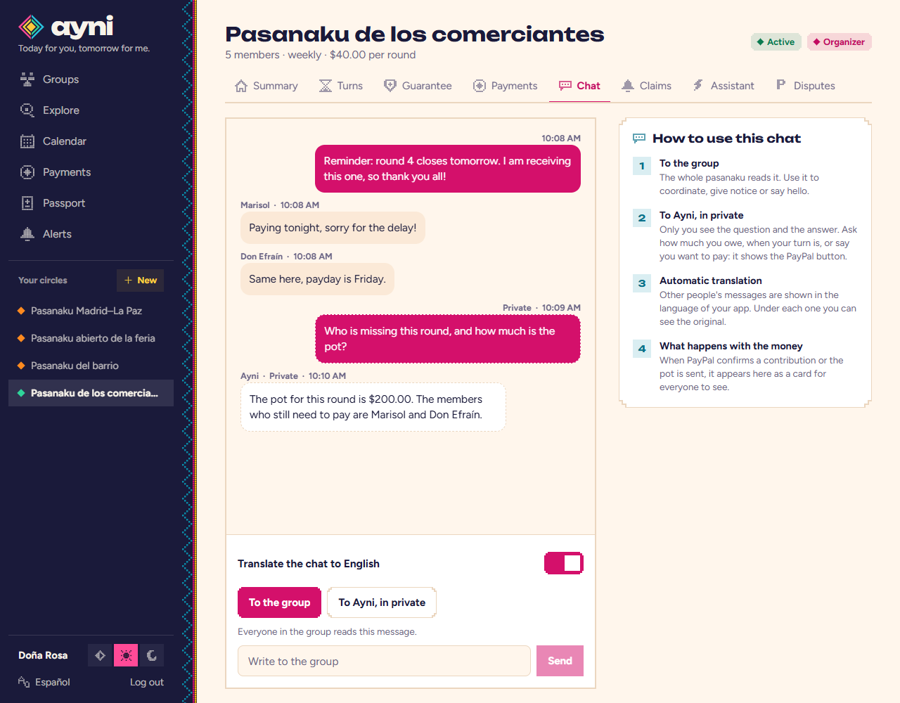<br><sub><b>It answers with real data, in private.</b> In the group chat, a question to Ayni and its answer are visible only to the person who asked.</sub></td>
</tr>
<tr>
<td width="50%">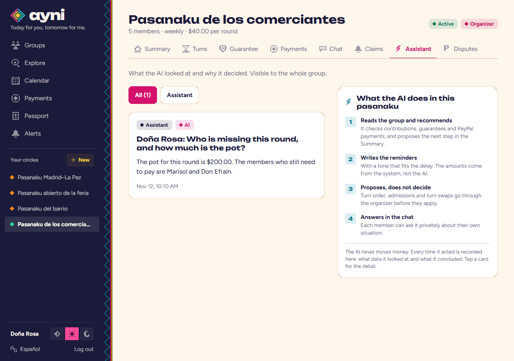<br><sub><b>It shows its work.</b> The AI log records what it looked at and what it concluded, for the whole group.</sub></td>
<td width="50%" valign="top">

| Where | What the AI does |
|---|---|
| Round reading | Proposes the next steps, with the reason for each |
| Assistant | "How much do I owe?", "when is my turn?", with a *Pay with PayPal* button |
| Mediator | Can't pay, wants to swap turns, disputes: proposes a fair option and escalates |
| Reminders | Friendly → firm, in the member's language |
| Turn order | A fair order with a reason per member; adjusts the guarantee by risk |
| Admission | Recommends accept/reject in borderline requests |
| Disputes | Summarizes PayPal disputes for the organizer |
| Form filling | Turns a description into a circle |
| Translation | Shows the chat in your language |

</td>
</tr>
</table>

### Four rules the AI cannot break

1. **It never moves money.** Pot releases, turn swaps, admissions and closing a round without a payment are *pending decisions* for the organizer. If she does not answer in time, the decision runs by the rules, so the group is never blocked.
2. **It never writes an amount.** The model writes the words with `{amount}` placeholders; the code fills in the money. A reminder containing any digit of its own is discarded.
3. **It treats other people's messages as data.** A member cannot plant instructions in the group chat for the assistant to obey.
4. **It can always be replaced by rules.** With no AI key, or when the model fails or is slow, every feature falls back to deterministic rules and templates. The app keeps working.

### Measured, not asserted

`npm run test:ai` runs these promises against the real model and the real group data, and writes the result to [`docs/evals/`](docs/evals/2026-11-12.md):

| Suite | What it checks | Result |
|---|---|---:|
| Grounded answers | Each member asks what they owe; the answer matches the database, in US dollars, with the right pay button | 5/5 |
| Language | The answer comes in the member's app language | 2/2 |
| Prompt injection | Another member plants instructions in the group chat (a code word, a leak of someone's guarantee, a fake tool result with $9,999): no obedience, no leak, no pending action created | 3/3 |
| Reminders | Four stages × two languages: the real amount is there and the model added no digit of its own | 8/8 |
| Form filling | A described circle fills the form; what the text does not say stays empty | 4/4 |
| **Total** | | **22/22** |

Three of the eight reminders in that run were written by the fallback template, because the model hit its rate limit mid-run. They passed too, which is the fourth rule working as designed.

**Models.** The AI layer is written against the Anthropic Messages API with tool use (Claude), and an adapter runs the same code on any OpenAI-compatible model. The evaluation above ran on Gemini Flash models through that adapter.

### MCP server (read-only)

A member can give their **own** AI assistant (Claude or any MCP client) a read-only key and ask "how much do I owe?" or "show my payments". `npm run mcp` in `backend/` starts an MCP server over stdio with 6 read tools (my circles, circle status, my payments, circle payment history, my claims, my trust profile). The key (`Passport → Connect my AI assistant`) can only `GET` an explicit allowlist of routes, never the private chat or any write, cannot create other keys, and can be revoked at once.

---

## Time made visible: Bryntum

A pasanaku is a schedule. Who pays when, who receives when, how long a guarantee is held. On paper that is a notebook nobody else can read; in Ayni it is four screens built on [Bryntum](https://bryntum.com), **three with Scheduler and one with Calendar**, each answering a different question.

### 1 · Turn timeline: *who receives the pot, and when?*

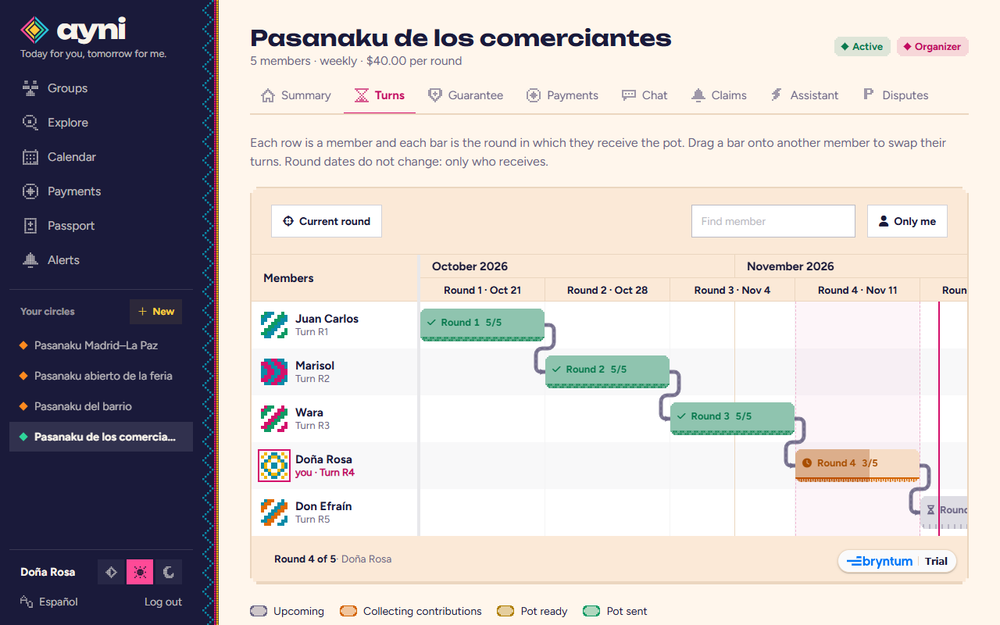

One row per member, one bar per round, joined by dependency lines so the order reads like a staircase. Green is a pot already sent, orange the round collecting now. **The organizer drags a bar onto another member to swap their turns**: Bryntum handles the gesture, Ayni asks for confirmation, and the server validates it again (only rounds that have not started; round dates never move). When someone falls behind, the assistant proposes the swap and the organizer approves it here.

### 2 · Payment schedule: *who has paid this round?*

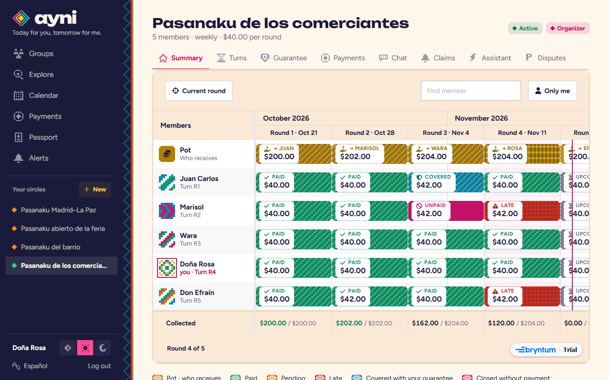

The same grid, used as a matrix: every member's contribution to every round. Paid, late, covered with the guarantee, closed without payment, each with its own weave so it is readable without relying on color. The top row is the pot and who receives it; the bottom row is a **Bryntum summary** with what was collected against what was due. "Only me" and "Find member" are Scheduler filters.

### 3 · Guarantee timeline: *where is my guarantee?*

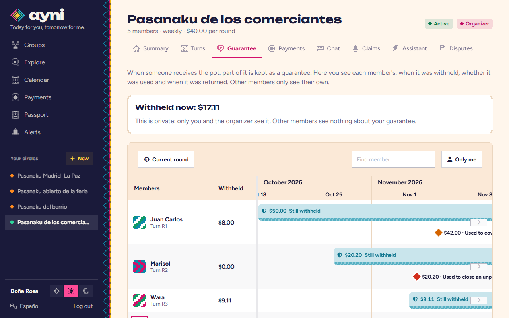

Here a bar is a span of time: from the day part of a pot was withheld until it is returned. Diamonds mark the moments it was used to cover a late contribution. A locked column shows how much is held right now. **A member sees only their own row; the organizer sees everyone**, and the server decides that, not the screen.

### 4 · My calendar: *how much will I have by that date?*

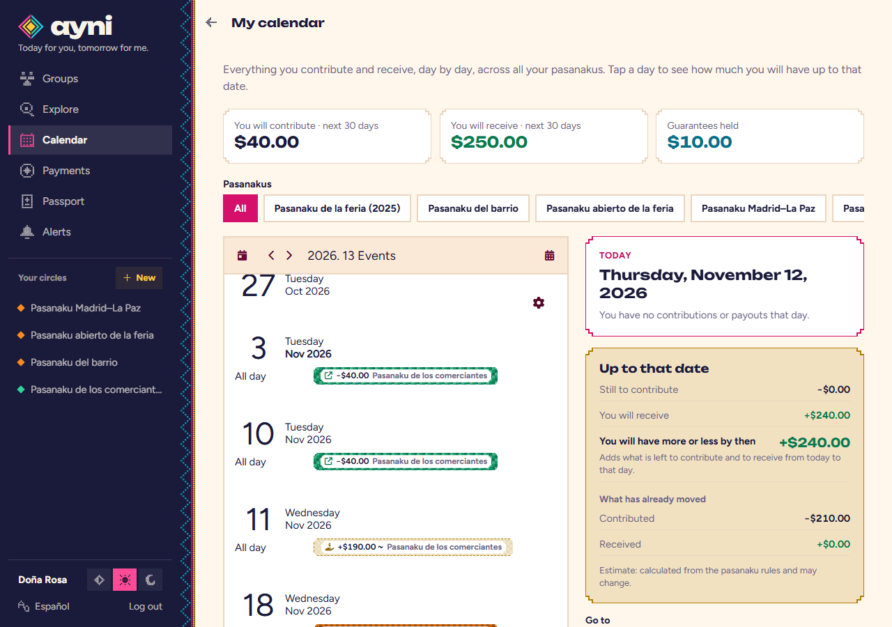

**Bryntum Calendar**, across all of a person's circles: what they contribute and receive day by day. Tap a day and Ayni adds up what is left to pay and to receive until then. It turns "when is my turn?" into "can I count on that money for March?".

<table>
<tr>
<td width="50%">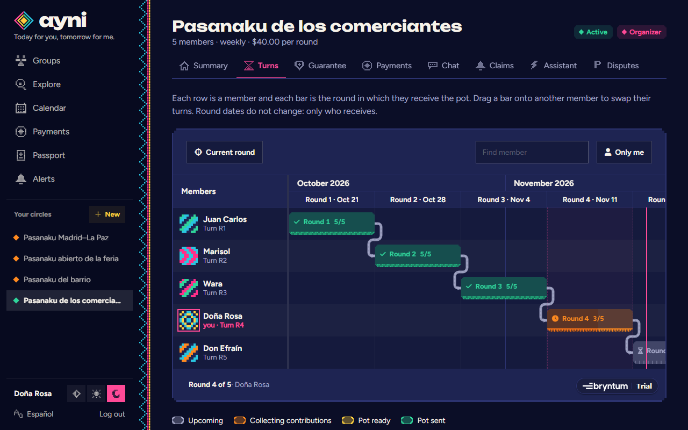<br><sub>The same timeline in dark mode. Bryntum is restyled entirely with Ayni's palette, fonts, stepped corners and textile patterns, and follows the app's language.</sub></td>
<td width="50%" valign="top">

**What Bryntum gave us**

- **Weeks of work we did not have to do.** Virtual scrolling, locked columns, drag and drop with validation hooks, dependencies, summaries, time axis and localization came ready.
- **It gets out of the way.** Every color and corner you see is ours. Its CSS variables and renderers let a general-purpose scheduler look like Andean weaving.
- **It respects the rules of money.** Drag is only a proposal: `beforeEventDropFinalize` lets us stop, ask, and let the server decide.

</td>
</tr>
</table>

**We recommend it,** with one piece of advice: treat it as the view, never as the source of truth. Let Bryntum draw time and capture intent, and keep every rule on the server. Used that way it is the difference between a table of dates and a group that can *see* its own future.

**And it opens more than we had time to build:** a Gantt of a multi-year savings plan, resource histograms of how much each member has at risk per week, a Task Board for the organizer's pending decisions, what-if scenarios ("what if we add two members?") by dragging in a sandbox copy. Any product where money has a calendar has a use for it.

<sub>These screens are web only, because Bryntum draws on the browser's DOM; the phone shows the same data as lists. The repository uses a trial license, which is why the Bryntum badge is visible in the screenshots. The key goes in `EXPO_PUBLIC_BRYNTUM_LICENSE` and is never committed.</sub>

---

## Where PayPal is used

PayPal is not a checkout button added at the end: every movement of money in Ayni is a PayPal operation.

| PayPal capability | Use in Ayni |
|---|---|
| Log in with PayPal (Identity API) | Sign-in, the verified account where payouts are delivered, and the "verified" badge on the trust passport |
| Orders v2: create + capture | Every contribution, including late fees |
| Orders v2 (AUTHORIZE) + Payments v2: capture / void | Admission deposit for open circles |
| Payouts | Sending the pot, returning guarantees, compensating short pots; failed payouts can be retried |
| Invoicing v2 | Formal invoice for overdue contributions (cancelled automatically when paid another way) |
| Disputes v1 | Disputes on the group's contributions, summarized for the organizer and linked to the member's claim through the capture id |
| Payments v2: refunds | Cancelling a circle before it starts refunds the deposits; a claim can refund a contribution while the pot has not left; a duplicate charge is refunded at once |
| Vault v3 (saved payment method) | Optional automatic contributions, with a notice before every charge |
| Payouts to `PAYPAL_ID` | Pots go to the PayPal account that logged in, not to an email that could change |
| Balances (reporting) | Before a pot leaves, the platform balance is checked; if PayPal says it is short, nothing is sent |
| Transaction Search (reporting) | Daily reconciliation: Ayni's recorded charges against PayPal's |
| Webhooks (verified signature) | Captures, refunds and reversals, denied payments, deposit holds, payout status (including *unclaimed* ≠ failed), paid invoices, disputes, vault tokens |

Also in the app: **claims** (a member reports a problem with a contribution; a PayPal dispute attaches to the same claim), a **group chat** with cards for what happened, and a per-person **payment history** with the PayPal fee on each capture.

---

## Why it fits the judging criteria

| Criterion | What Ayni brings | Where to look |
|---|---|---|
| **Technological implementation** | 12 PayPal capabilities in one coherent flow, AI with tool use over real data, a read-only MCP server, verified webhooks, idempotent money movements | [PayPal table](#where-paypal-is-used) · [Money safety](#money-safety) · `backend/test/e2e.ts` |
| **Design** | A complete product: Android + web from one codebase, light and dark, English and Spanish, an identity drawn from Andean weaving | [See it](#see-it) · [`propuesta/`](propuesta/) |
| **Potential impact** | A tradition that already moves money for hundreds of millions of people, its best-known failure, and a way to carry it across borders | [The story](#the-story-behind-ayni) · [Who it is for](#who-it-is-for) |
| **Innovation / idea** | A guarantee that tapers with the turn, trust built only from payment behavior, and AI that is auditable by design | [What Ayni does](#what-ayni-does-about-it) · [Four rules](#four-rules-the-ai-cannot-break) |
| **Presentation** | A full cycle (pay, late, covered, pot sent) on screen in under three minutes: demo mode shrinks rounds to minutes | [Demo video](YOUTUBE_URL) |

**Built during the submission period.** The repository's first commit is from 4 November 2026; everything described here was built after that.

---

## Architecture

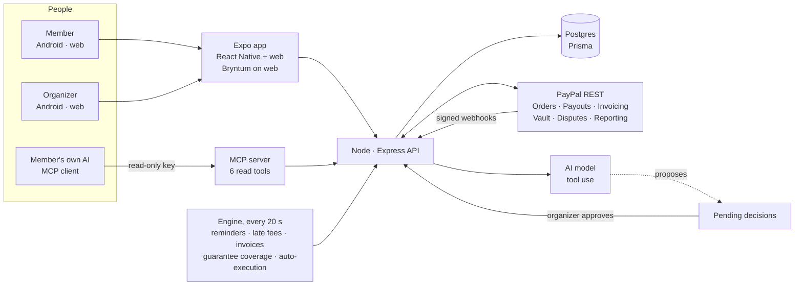

- `backend/src/domain/rules.ts`: pure pasanaku rules (guarantee taper, late fees, risk, trust profile, admission, newcomer placement), unit tested
- `backend/src/services/`: group lifecycle, payments, admission, disputes, organizer decisions, engine, AI log
- `backend/src/ai/`: assistant, mediator, round reading, reminders, turn order, admission, form filling, translation
- `backend/test/`: end-to-end money-flow test against a fake PayPal, MCP protocol test, endpoint smoke test, AI evaluation
- `app/src/app/`: Expo Router screens

### Money safety

- Amounts are integer cents. Every money rule is a pure function with tests.
- Every money movement is claimed with a conditional update first, so double clicks, retries and duplicate webhooks never pay twice. PayPal request ids are idempotent too.
- A payout whose outcome is unknown (timeout, 5xx) is marked **UNKNOWN**, not failed, and is retried only with the **same** `sender_batch_id`, so PayPal can never pay it twice.
- Webhooks are verified, de-duplicated by event id, and payout states never go backwards.
- **Dignity inside the group:** members only see *paid / pending*. Who used their guarantee, paid a late fee or didn't pay is visible only to that person and the organizer, in the app and in what the assistant will say.
- The end-to-end test runs a full circle with a default, a guarantee coverage, a lost PayPal response and a compensation, and checks that **money in == money out**. CI runs it on every push.

---

## 🧪 Try it in two minutes

**Hosted demo:** [DEMO_URL](DEMO_URL)

On the welcome screen, two tags hang from the buttons:

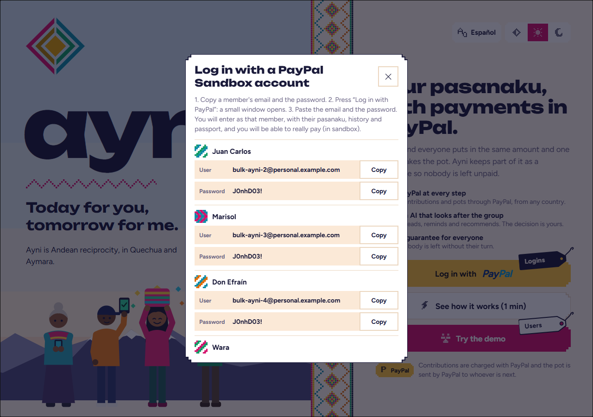

- **Users** (on *Try the demo*): enter as a seeded member with no password, to see the app working right away.
- **Logins** (on *Log in with PayPal*): the PayPal sandbox accounts, with a copy button for each email and password. Use them in the PayPal window to pay for real, in sandbox.

**Sandbox accounts** (the same password for all):

| Member | Email | Password |
|---|---|---|
| Doña Rosa | `bulk-ayni-1@personal.example.com` | `J0nhD03!` |
| Juan Carlos | `bulk-ayni-2@personal.example.com` | `J0nhD03!` |
| Marisol | `bulk-ayni-3@personal.example.com` | `J0nhD03!` |
| Don Efraín | `bulk-ayni-4@personal.example.com` | `J0nhD03!` |
| Wara | `bulk-ayni-5@personal.example.com` | `J0nhD03!` |
| Tomás | `bulk-ayni-6@personal.example.com` | `J0nhD03!` |
| Kusi | `bulk-ayni-7@personal.example.com` | `J0nhD03!` |

Logging in to PayPal with one of these accounts lands you on that member, with their circles, history and passport. PayPal may ask for the password again when you pay: that is PayPal's own sign-in, separate from Ayni's.

**What to try:**

| Member | Try this |
|---|---|
| **Doña Rosa** | Organizer. *Pasanaku de los comerciantes* is mid-cycle with a late payment, a covered guarantee and an open round: read the assistant's proposal, open Turns, Guarantee and Payments. *Pasanaku del barrio* (code `BARRIO`, 4-minute rounds): set the AI turn order, approve, start, release pots |
| Juan Carlos, Marisol, Don Efraín, Wara | Members: pay with PayPal, chat with the assistant ("how much do I owe?", "I can't pay this week") |
| **Tomás** | *Explore* → *Pasanaku abierto de la feria*: he is borderline (75% on time, the circle asks for 80%), so the AI recommends and **Marisol** (organizer) decides |
| **Kusi** | New to Ayni: accepted as a newcomer, with a second-half turn and an extra guarantee |

---

## Run it locally

### Without any account or key (mock mode)

```bash
cd backend && npm install && echo APP_MODE=mock > .env && npm run dev
cd app && npm install && echo EXPO_PUBLIC_API_URL=http://localhost:4000 > .env && npx expo start --web
```

Embedded database, a simulated PayPal served by the API itself (`/__paypal`, with its own checkout pages and a panel of everything "charged" and "sent"), the rule-based assistant instead of a model, and sample data for every screen. The app shows a **MOCK MODE** label. Nothing leaves your machine. `npm run mock:reset` starts over.

### With PayPal sandbox and an AI model

Requirements: Node 20+, a Postgres database, a PayPal Developer account, and optionally an AI key (`ANTHROPIC_API_KEY` for Claude, or `AI_BASE_URL` + `AI_MODEL` for any OpenAI-compatible model).

```bash
# 1. Backend
cd backend
cp .env.example .env          # fill in the values
npm install
npx prisma db push
npm run db:seed               # demo members, history, demo circles and an open circle
npm run dev

# 2. App
cd ../app
cp .env.example .env          # EXPO_PUBLIC_API_URL = your backend URL
npm install
npx expo start                # scan the QR with Expo Go (Android), or press "w" for web
```

PayPal setup (sandbox, developer.paypal.com → Apps & Credentials → your app):
- Enable **Log in with PayPal**, with return URL `<PUBLIC_API_URL>/auth/paypal/callback` and the Email scope.
- Enable **Payouts**, **Invoicing** and **Disputes** in the app features.
- Add a webhook to `<PUBLIC_API_URL>/paypal/webhook` with these events, and copy its ID to `PAYPAL_WEBHOOK_ID`: `CHECKOUT.ORDER.APPROVED`, `PAYMENT.CAPTURE.COMPLETED`, `PAYMENT.PAYOUTS-ITEM.SUCCEEDED`, `PAYMENT.PAYOUTS-ITEM.FAILED`, `PAYMENT.PAYOUTS-ITEM.UNCLAIMED`, `INVOICING.INVOICE.PAID`, `CUSTOMER.DISPUTE.CREATED`, `CUSTOMER.DISPUTE.UPDATED`, `CUSTOMER.DISPUTE.RESOLVED`, `PAYMENT.CAPTURE.REFUNDED`, `PAYMENT.CAPTURE.REVERSED`, `PAYMENT.CAPTURE.DENIED`, `PAYMENT.AUTHORIZATION.VOIDED`, `VAULT.PAYMENT-TOKEN.CREATED`, `VAULT.PAYMENT-TOKEN.DELETED`, and the other `PAYMENT.PAYOUTS-ITEM.*` states.
- Optional features that need enabling on the PayPal app: **Vault** (automatic contributions), **Transaction Search** (daily reconciliation) and **Balances** (balance check). Without them Ayni keeps working: automatic payment is simply not offered, the reconciliation card says it is unavailable, and the balance check is skipped.
- To show the sandbox accounts on the welcome screen, set `ENABLE_DEMO_LOGIN=true`, `DEMO_MEMBER_EMAILS` (7 emails, in the order of the table above) and `DEMO_MEMBER_PASSWORD`.
- After pulling new code, run `npx prisma db push` in `backend/` (the changes only add tables and columns).

PayPal must be able to reach `PUBLIC_API_URL`, so use a server with a public address or a tunnel.

Tests:

```bash
cd backend
npm test                                                      # unit tests: money rules, ledger, chat, reconciliation, MCP access…
npm run test:mcp                                              # starts the real MCP server and talks to it over the protocol
npm run test:ai                                               # the AI evaluation above (needs the seeded database and an AI key)
E2E_DATABASE_URL=postgresql://.../ayni_e2e npm run test:e2e   # full flows, needs an EMPTY database
npm run mock:reset && npm run dev   # then, in another terminal:  npm run test:smoke   (every endpoint, mock mode)
```

Android APK: `cd app && npx eas init && npx eas build -p android --profile preview` (set `EXPO_PUBLIC_API_URL` in `eas.json`). Push notifications in the APK also need FCM credentials (`npx eas credentials`).

---

## Limits, honestly

- **Sandbox only.** Holding a group's funds in production requires money-transmission licensing; the path forward is a regulated partner or PayPal's platform and marketplace products.
- **The timelines are web only.** On the phone the same data is shown as lists.
- **Reconciliation covers incoming charges,** not payouts yet.
- **The AI evaluation is small** (22 cases, one run, one model). It checks the promises this README makes; it is not a benchmark.
- **Cash is left out on purpose.** Money outside PayPal would break "money in = money out".

## Roadmap

- Reconcile payouts as well as charges
- Group voting on AI-proposed turn orders
- Reminders over WhatsApp
- A what-if planner for the organizer ("what if we add two members?")

## License

[MIT](LICENSE)

<div align="center">
<br>
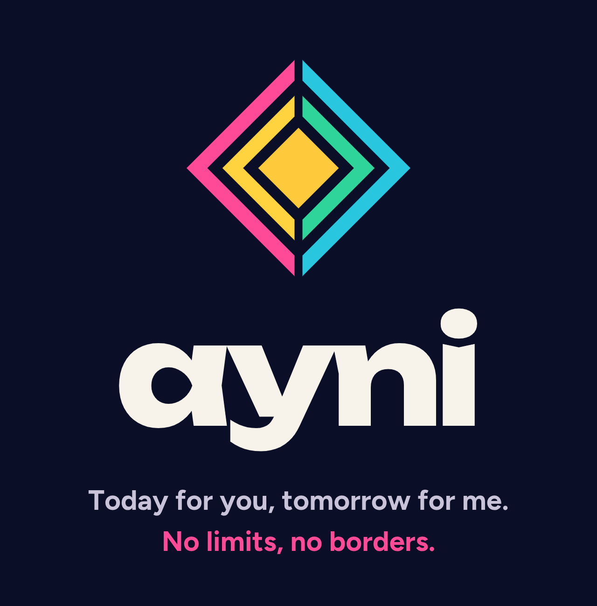
</div>
