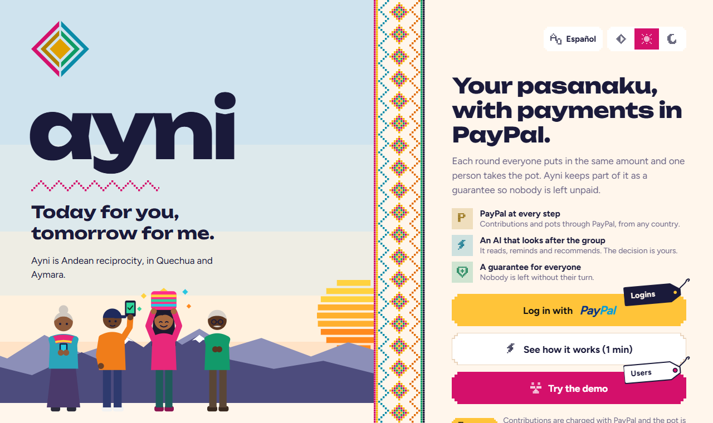

<div align="center">

# ayni

### Rotating savings circles, built on PayPal and Claude.
*Today for you, tomorrow for me.*

**English** · [Español](README.es.md)



[▶ Demo video](YOUTUBE_URL) &nbsp;·&nbsp; [🌐 Live demo](RENDER_URL) &nbsp;·&nbsp; [📱 Android APK](APK_URL) &nbsp;·&nbsp; [🧪 Judges: test accounts](#-try-it-in-two-minutes)


</div>

---

## The problem

Hundreds of millions of people save in **rotating groups** (*pasanaku* in Bolivia, *tanda* in Mexico, *ROSCA* everywhere else). Everyone contributes the same amount each week or month, and each round one member takes the whole pot. No bank, no interest, no paperwork.

They run on trust, and they break in two predictable ways:

1. **The person who receives the pot early stops paying.** The rest of the group is left holding the loss.
2. **They only work among people who already know each other.** A migrant in Madrid cannot save with their family in La Paz, and a stranger cannot be trusted with the pot.

## The solution

Ayni keeps the tradition and fixes both problems. Every contribution and every pot moves through **PayPal**, and **Claude** helps the group run itself, but never touches the money.

<table>
<tr>
<td width="33%" valign="top">

### 🛡 Staggered guarantee
Whoever receives early gets most of the pot now; a part is **withheld and returned automatically** once they finish contributing. Turn #1 carries the largest guarantee, the last turn none. If someone stops paying, the group is covered from their own guarantee.

</td>
<td width="33%" valign="top">

### 🪪 Verified trust passport
Completed circles, on-time rate, late payments, PayPal-verified account. Built **only from how you pay inside Ayni**, never from age, origin or gender. It lets strangers form **open circles** across countries.

</td>
<td width="33%" valign="top">

### 🤖 AI that proposes, never pays
Claude reads the group, writes reminders, mediates conflicts and recommends admissions. Everything that moves money becomes a **decision the organizer approves**, and every AI action is written to a log the whole group can read.

</td>
</tr>
</table>

---

## See it

<table>
<tr>
<td width="50%"><br><sub><b>The circle at a glance.</b> The pot, your turn, the assistant's reading of the round with the next steps, and the payment schedule.</sub></td>
<td width="50%"><br><sub><b>Turn timeline</b> with Bryntum Scheduler. Who receives the pot in which round; the organizer drags a turn to swap it.</sub></td>
</tr>
<tr>
<td width="50%"><br><sub><b>Guarantee timeline.</b> When each guarantee was withheld, used to cover a late contribution, or returned. Private to the member and the organizer.</sub></td>
<td width="50%"><br><sub><b>Every cent, traced to PayPal.</b> Charges, payouts, fees and references, with filters. Money in equals money out.</sub></td>
</tr>
<tr>
<td width="50%"><br><sub><b>Group chat + private assistant.</b> Ask "who is missing?" and get real data; the answer is visible only to you.</sub></td>
<td width="50%"><br><sub><b>AI log.</b> What the AI looked at, what it decided, and whether it came from Claude or from the fallback rules.</sub></td>
</tr>
<tr>
<td width="50%"><br><sub><b>Open circles between strangers,</b> by country. The threads join members who pay from another country.</sub></td>
<td width="50%"><br><sub><b>Trust passport.</b> Level, on-time rate, achievements and history, built only from payment behavior.</sub></td>
</tr>
</table>

<table>
<tr>
<td width="33%"></td>
<td width="33%"></td>
<td width="33%"></td>
</tr>
<tr>
<td align="center"><sub>Android app + web, one codebase</sub></td>
<td align="center"><sub>Built for the phone first</sub></td>
<td align="center"><sub>Light and dark themes</sub></td>
</tr>
</table>

---

## How a circle works

1. **Create a circle.** Contribution, frequency, late fee, and how turns are decided (lottery, organizer, or AI).
2. **Members join** with an invite code and **log in with PayPal**, so Ayni knows exactly where to send their pot.
3. **Each round**, members pay with PayPal Checkout. When everyone has paid, the organizer confirms and the pot is sent with **PayPal Payouts**.
4. **Staggered guarantee.** Whoever receives early gets most of the pot now; the rest is held and returned when they finish. Claude's risk assessment moves the percentage by at most ±10 points.
5. **Late payments** get escalating reminders written by Claude, a late fee that goes to the pot, a **PayPal invoice** at the "firm" stage, and, when the grace period ends, the contribution is covered from the member's own guarantee.
6. **If someone really doesn't pay** and has no guarantee left, the organizer can close the round without them so the group is never stuck. The debt is taken out of the defaulter's own future pot and **paid back to whoever received less**. It stays on their trust profile.

### Open circles between strangers

- **Trust profile:** completed and abandoned circles, % of on-time payments, late payments, times their guarantee was used, account age, PayPal-verified account.
- **Organizer rules:** minimum completed circles, minimum % on time, maximum late payments, and whether newcomers are accepted.
- **Admission modes:** manual, automatic by rules, or **rules + AI**: automatic when the rules are met; in borderline cases (one rule missed by a small margin) Claude explains and recommends, and the organizer decides.
- **Admission deposit:** asking to join places a PayPal **authorization** for one contribution, which is not charged. If rejected it is **voided**; if accepted it is **captured** and counts as their round-1 contribution.
- **Newcomers** (no history) always take a second-half turn and an extra guarantee, so they can build a reputation without putting the group at risk.

---

## Where AI is used

| Feature | What Claude does |
|---|---|
| Group assistant | Answers "how much do I owe?", "when is my turn?", "who's missing?" using tools over real group data, and shows a *Pay with PayPal* button |
| Round reading | Looks at the state of the round and proposes the next steps (remind, invoice, retry a payout) with the reason for each |
| Mediator | Handles conflicts (can't pay this round, wants to swap turns, PayPal disputes), proposes a fair option and escalates to the organizer |
| Smart reminders | Writes personalized reminders that escalate from friendly to firm, in the member's language |
| Turn order + guarantee | Proposes a fair turn order with a reason for each member, based on payment history; the guarantee % is adjusted by risk |
| Admission | In borderline join requests, recommends accept/reject with a plain-language explanation |
| Disputes | Summarizes PayPal disputes on the group's contributions for the organizer |
| Chat translation | Shows other members' messages in your language, with the original underneath |

**Safety by design: the AI can read and propose, but never moves money.** Pot releases, turn swaps, AI-proposed orders, admissions and closing a round without a payment all become *pending decisions* that the organizer approves. If the organizer doesn't answer in time, the decision runs automatically, so the group is never blocked.

**Transparency.** Every AI decision is written to a per-group **AI log**, visible to all members: what the AI looked at (tools, data), what it decided, and whether it came from Claude, from the rules, or from the fallback used when the AI is unavailable.

**Resilience.** Without an `ANTHROPIC_API_KEY` (or if Claude fails), every feature falls back to deterministic rules and templates, and the app keeps working.

**Privacy.** A member's questions to Ayni and its answers are private to that member. Messages from other members are treated as data, never as instructions.

### MCP server (read-only)

A member can give their **own** AI assistant (Claude or any MCP client) a read-only key and ask "how much do I owe?" or "show my payments". `npm run mcp` in `backend/` starts an MCP server over stdio with 6 read tools (my circles, circle status, my payments, circle payment history, my claims, my trust profile). The key (`Passport → Connect my AI assistant`) can only `GET` an explicit allowlist of routes, never the private chat or any write, cannot create other keys, and can be revoked at once.

---

## Also in the app

- **Payment history** per circle and per person, with PayPal references, the fee on each capture and a *Verified with PayPal* card.
- **Group chat** with cards for what happened (paid, pot sent…), rate limiting and text sanitizing. The author or the organizer can hide a message.
- **Claims:** a member reports a problem with a contribution; the organizer refunds it or explains. If the member opens a PayPal dispute, it attaches to the same claim and PayPal's decision is written there.
- **Automatic contributions (PayPal Vault):** optional, and the member is **told before every charge** and can turn it off at any time.
- **Daily reconciliation** with PayPal Transaction Search: Ayni's recorded charges are compared with PayPal's, and differences reach the organizer.

### Timelines with Bryntum Scheduler (web)

Three screens of a circle use [Bryntum Scheduler](https://bryntum.com/products/scheduler/), one row per member:

- **Turn timeline:** who receives the pot in which round. The organizer drags a turn onto another member to swap them (always with a confirmation, validated again by the server, only for rounds that have not started).
- **Payment calendar:** each member's contribution to each round (paid, pending, late…), a star on whoever receives the pot. Read-only.
- **Guarantee timeline:** when each guarantee was withheld, used, returned or refunded. A member sees only their own; the organizer sees everyone.

Bryntum draws on the browser's DOM, so these screens are web only. The license key goes in `EXPO_PUBLIC_BRYNTUM_LICENSE` (never committed; see `app/.env.example`).

---

## Where PayPal is used

PayPal is not a checkout button added at the end: every movement of money in Ayni is a PayPal operation.

| PayPal capability | Use in Ayni |
|---|---|
| Log in with PayPal (Identity API) | Sign-in, the verified email where payouts are delivered, and the "verified" badge on the trust profile |
| Orders v2: create + capture | Every contribution, including late fees |
| Orders v2 (AUTHORIZE) + Payments v2: capture / void | Admission deposit for open circles |
| Payouts | Sending the pot, returning guarantees, compensating short pots; failed payouts can be retried |
| Invoicing v2 | Formal invoice for overdue contributions (cancelled automatically when paid another way) |
| Disputes v1 | Disputes on the group's contributions, summarized for the organizer and linked to the member's claim through the capture id |
| Payments v2: refunds | Cancelling a circle before it starts refunds the deposits; a claim can refund a contribution while the pot has not left; a duplicate charge is refunded at once |
| Vault v3 (saved payment method) | Optional automatic contributions, with a notice before every charge |
| Payouts to `PAYPAL_ID` | Pots go to the PayPal account that logged in, not to an email that could change |
| Balances (reporting) | Before a pot leaves, the platform balance is checked; if PayPal says it is short, nothing is sent |
| Transaction Search (reporting) | Daily reconciliation of charges |
| Webhooks (verified signature) | Captures, refunds and reversals, denied payments, deposit holds, payout status (including *unclaimed* ≠ failed), paid invoices, disputes, vault tokens |

---

## Why it fits the judging criteria

| Criterion | What Ayni brings |
|---|---|
| **Technological implementation** | 12 PayPal capabilities in one coherent flow, Claude with tool use over real data, a read-only MCP server, verified webhooks, idempotent money movements, and a full end-to-end test that checks *money in = money out*. |
| **Design** | A complete product, not a proof of concept: Android + web from one codebase, light and dark themes, ES/EN, an identity drawn from Andean weaving, and accessible components. |
| **Potential impact** | A real tradition that already moves money for hundreds of millions of people, with a real failure (the early recipient who stops paying) and a way to extend it to families and strangers across borders. |
| **Innovation / idea** | A guarantee that tapers with the turn, a trust profile built only from payment behavior, and AI that is auditable by design: it proposes, humans decide, and every action is logged. |
| **Presentation** | A demo that fits in under three minutes: demo mode shrinks rounds to minutes so a full cycle (pay, late, covered, pot sent) happens on screen. |

**Built during the submission period.** The repository's first commit is from 4 November 2026; everything described here was built after that.

---

## Architecture

```
Expo app (Android + web)  ──►  Node/Express API (Render)  ──►  PayPal REST (sandbox)
                                   │        │
                                   │        └──►  Claude (Anthropic API, tool use)
                                   └──►  Postgres on Neon (Prisma)
   Engine (every 20 s): reminders · late fees · invoices · guarantee coverage · auto-execution
```

- `backend/src/domain/rules.ts`: pure pasanaku rules (guarantee taper, late fees, risk, trust profile, admission, newcomer placement), unit tested
- `backend/src/services/`: group lifecycle, payments, admission, disputes, organizer decisions, engine, AI log
- `backend/src/ai/agent.ts`: Claude assistant, mediator, reminders, turn order, admission and dispute summaries
- `backend/test/e2e.ts`: end-to-end money-flow test against a fake PayPal
- `app/src/app/`: Expo Router screens

### Money safety

- Amounts are integer cents. Every money rule is a pure function with tests.
- Every money movement is claimed with a conditional update first, so double clicks, retries and duplicate webhooks never pay twice. PayPal request ids are idempotent too.
- A payout whose outcome is unknown (timeout, 5xx) is marked **UNKNOWN**, not failed, and is retried only with the **same** `sender_batch_id`, so PayPal can never pay it twice.
- Webhooks are verified, de-duplicated by event id, and payout states never go backwards.
- **The AI never writes amounts.** Claude writes reminders with `{amount}` placeholders that the code fills in. Any digit written by the model discards the text.
- **Dignity inside the group:** members only see *paid / pending*. Who used their guarantee, paid a late fee or didn't pay is visible only to that person and the organizer.
- The end-to-end test runs a full circle with a default, a guarantee coverage, a lost PayPal response and a compensation, and checks that **money in == money out**. CI runs it on every push.

---

## 🧪 Try it in two minutes

**Hosted demo:** [RENDER_URL](RENDER_URL) (free tier: the first load can take about 30 s while the server wakes up).

On the welcome screen there are two tags next to the buttons:

- **Users** (on *Try the demo*): enter as a seeded member with no password, to see the app working right away.
- **Logins** (on *Log in with PayPal*): the PayPal sandbox accounts, with a copy button for each email and password. Use them in the PayPal window to pay for real, in sandbox.

**Sandbox accounts** (the same password for all):

| Member | Email | Password |
|---|---|---|
| Doña Rosa | `bulk-ayni-1@personal.example.com` | `J0nhD03!` |
| Juan Carlos | `bulk-ayni-2@personal.example.com` | `J0nhD03!` |
| Marisol | `bulk-ayni-3@personal.example.com` | `J0nhD03!` |
| Don Efraín | `bulk-ayni-4@personal.example.com` | `J0nhD03!` |
| Wara | `bulk-ayni-5@personal.example.com` | `J0nhD03!` |
| Tomás | `bulk-ayni-6@personal.example.com` | `J0nhD03!` |
| Kusi | `bulk-ayni-7@personal.example.com` | `J0nhD03!` |

Logging in to PayPal with one of these accounts lands you on that member, with their circles, history and passport. PayPal may ask for the password again when you pay: that is PayPal's own sign-in, separate from Ayni's.

**What to try:**

| Member | Try this |
|---|---|
| **Doña Rosa** | Organizer of *Pasanaku del barrio* (code `BARRIO`, 4-minute rounds): set the AI turn order, approve, start, release pots. Also *Pasanaku de los comerciantes*, already mid-cycle with a late payment, a covered guarantee and an open round |
| Juan Carlos, Marisol, Don Efraín, Wara | Members: pay with PayPal, chat with the assistant ("how much do I owe?", "I can't pay this week") |
| **Tomás** | *Explore* → *Pasanaku abierto de la feria*: he is borderline (75% on time, the circle asks for 80%), so the AI recommends and **Marisol** (organizer) decides |
| **Kusi** | New to Ayni: accepted as a newcomer, with a second-half turn and an extra guarantee |

---

## Run it locally

### Without any account or key (mock mode)

```bash
cd backend && npm install && echo APP_MODE=mock > .env && npm run dev
cd app && npm install && echo EXPO_PUBLIC_API_URL=http://localhost:4000 > .env && npx expo start --web
```

Embedded database, a simulated PayPal served by the API itself (`/__paypal`, with its own checkout pages and a panel of everything "charged" and "sent"), the rule-based assistant instead of Claude, and sample data for every screen. The app shows a **MOCK MODE** label. Nothing leaves your machine. `npm run mock:reset` starts over.

### With PayPal sandbox and Claude

Requirements: Node 20+, a Postgres database, a PayPal Developer account, an Anthropic API key (optional).

```bash
# 1. Backend
cd backend
cp .env.example .env          # fill in the values
npm install
npx prisma db push
npm run db:seed               # demo members, history, demo circles and an open circle
npm run dev

# 2. App
cd ../app
cp .env.example .env          # EXPO_PUBLIC_API_URL = your backend URL
npm install
npx expo start                # scan the QR with Expo Go (Android), or press "w" for web
```

PayPal setup (sandbox, developer.paypal.com → Apps & Credentials → your app):
- Enable **Log in with PayPal**, with return URL `<PUBLIC_API_URL>/auth/paypal/callback` and the Email scope.
- Enable **Payouts**, **Invoicing** and **Disputes** in the app features.
- Add a webhook to `<PUBLIC_API_URL>/paypal/webhook` with these events, and copy its ID to `PAYPAL_WEBHOOK_ID`: `CHECKOUT.ORDER.APPROVED`, `PAYMENT.CAPTURE.COMPLETED`, `PAYMENT.PAYOUTS-ITEM.SUCCEEDED`, `PAYMENT.PAYOUTS-ITEM.FAILED`, `PAYMENT.PAYOUTS-ITEM.UNCLAIMED`, `INVOICING.INVOICE.PAID`, `CUSTOMER.DISPUTE.CREATED`, `CUSTOMER.DISPUTE.UPDATED`, `CUSTOMER.DISPUTE.RESOLVED`, `PAYMENT.CAPTURE.REFUNDED`, `PAYMENT.CAPTURE.REVERSED`, `PAYMENT.CAPTURE.DENIED`, `PAYMENT.AUTHORIZATION.VOIDED`, `VAULT.PAYMENT-TOKEN.CREATED`, `VAULT.PAYMENT-TOKEN.DELETED`, and the other `PAYMENT.PAYOUTS-ITEM.*` states.
- Optional features that need enabling on the PayPal app: **Vault** (automatic contributions), **Transaction Search** (daily reconciliation) and **Balances** (balance check). Without them Ayni keeps working: automatic payment is simply not offered, the reconciliation card says it is unavailable, and the balance check is skipped.
- To show the sandbox accounts on the welcome screen, set `ENABLE_DEMO_LOGIN=true`, `DEMO_MEMBER_EMAILS` (7 emails, in the order of the table above) and `DEMO_MEMBER_PASSWORD`.
- After pulling new code, run `npx prisma db push` in `backend/` (the changes only add tables and columns).

PayPal must be able to reach `PUBLIC_API_URL`, so use a deployed URL (see `render.yaml`) or a tunnel.

Tests:

```bash
cd backend
npm test                                                      # unit tests: money rules, ledger, chat, reconciliation, MCP access…
npm run test:mcp                                              # starts the real MCP server and talks to it over the protocol
E2E_DATABASE_URL=postgresql://.../ayni_e2e npm run test:e2e   # full flows, needs an EMPTY database
npm run mock:reset && npm run dev   # then, in another terminal:  npm run test:smoke   (every endpoint, mock mode)
```

Android APK: `cd app && npx eas init && npx eas build -p android --profile preview` (set `EXPO_PUBLIC_API_URL` in `eas.json`). Push notifications in the APK also need FCM credentials (`npx eas credentials`).

---

## Roadmap

- Reconcile payouts too (today the daily check covers incoming charges only)
- Recording cash contributions is left out on purpose: money outside PayPal would break "money in = money out"
- Group voting on AI-proposed orders, and a WhatsApp channel for reminders
- In production, holding funds for a group requires money-transmission licensing; a regulated partner or PayPal's platform/marketplace products would be the path forward.

## License

[MIT](LICENSE)
